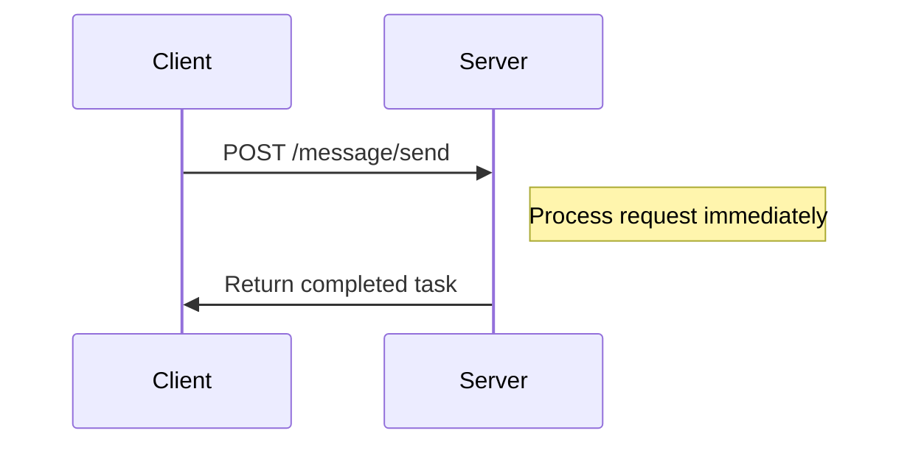
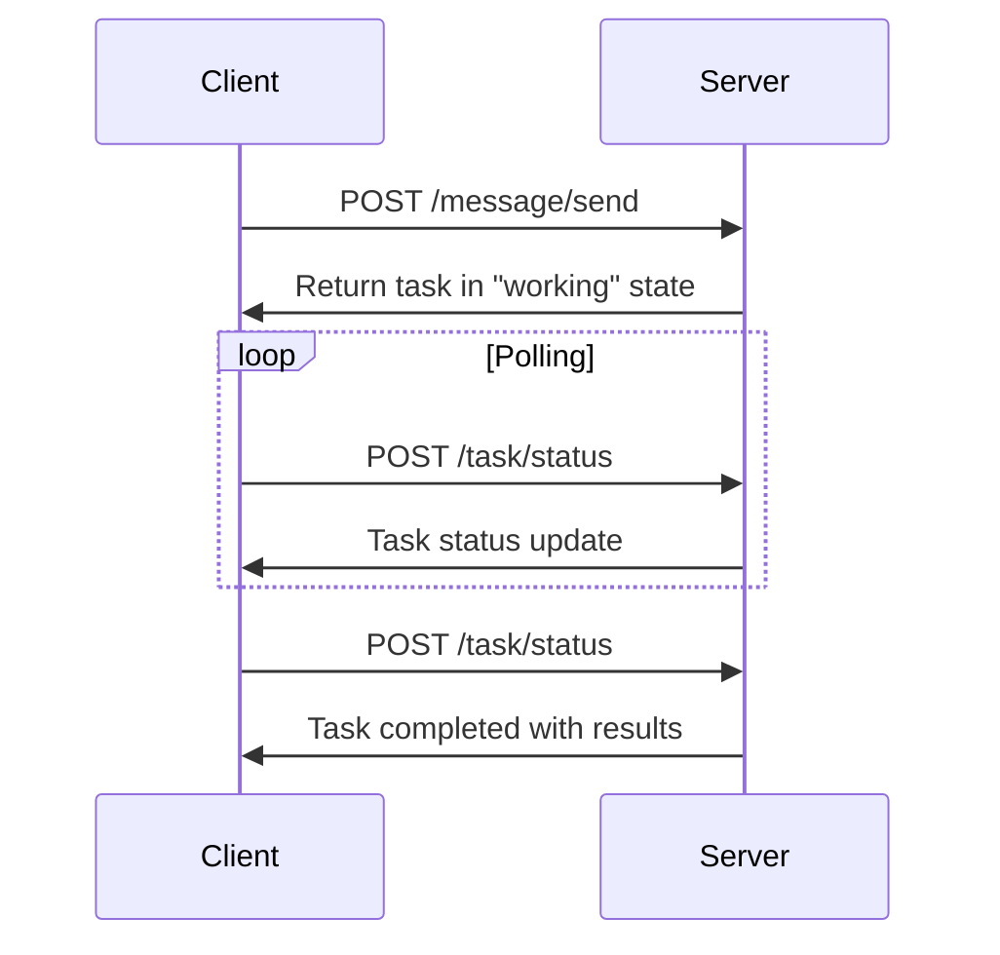
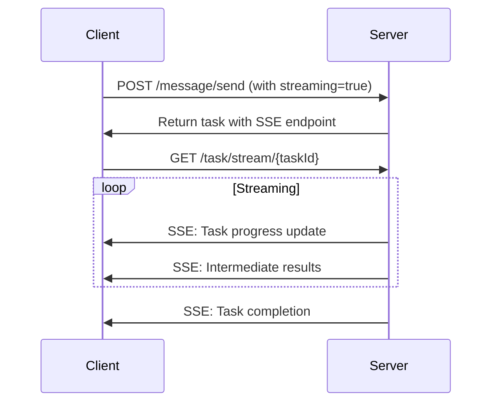
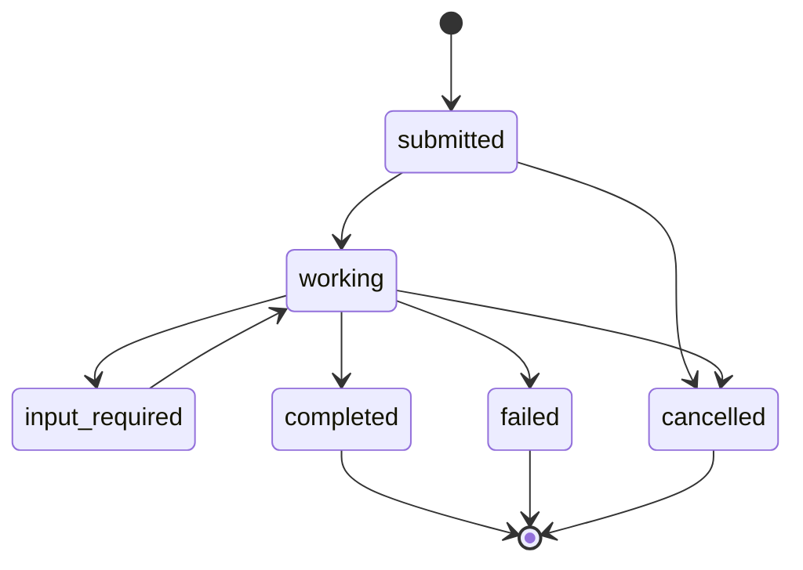

# 🤖 Google Agent-to-Agent (A2A) Protocol - Deep Dive Guide

## Table of Contents
1. [A2A Protocol Overview](#a2a-protocol-overview)
2. [Core Concepts & Components](#core-concepts--components)
3. [Protocol Implementation](#protocol-implementation)
4. [Message Flow & Communication](#message-flow--communication)
5. [Agent Discovery & Capabilities](#agent-discovery--capabilities)
6. [Task Lifecycle Management](#task-lifecycle-management)
7. [Project Implementation Details](#project-implementation-details)
8. [Advanced Features](#advanced-features)
9. [Interview Questions & Answers](#interview-questions--answers)

---

## A2A Protocol Overview

### What is the Agent-to-Agent (A2A) Protocol?

The **Agent-to-Agent (A2A) Protocol** is Google's open standard for enabling seamless communication and collaboration between AI agents. It's designed to create **interoperable agent ecosystems** where agents built on different platforms can work together to solve complex problems.

### Why A2A Protocol Matters

#### **Interoperability**
- Connects agents built on different platforms (LangGraph, CrewAI, Semantic Kernel)
- Enables cross-platform agent collaboration
- Standardizes agent communication across the industry

#### **Security & Opacity**
- Agents interact without sharing internal memory, tools, or proprietary logic
- Maintains agent autonomy while enabling collaboration
- Protects intellectual property and sensitive data

#### **Complex Workflows**
- Facilitates delegation and task orchestration between agents
- Enables information exchange and context sharing
- Supports real-time coordination for complex operations

### A2A vs MCP (Model Context Protocol)

| Aspect | A2A Protocol | MCP Protocol |
|--------|--------------|--------------|
| **Focus** | Agent-to-agent communication | Agent-to-tool/resource communication |
| **Purpose** | How agents partner and delegate work | How agents access specific capabilities |
| **Scope** | Inter-agent collaboration | Tool and API integration |
| **Analogy** | Business partnerships | Using a specific tool |

**Synergy**: An A2A client requests a task from an A2A server, which may use MCP to interact with underlying tools to fulfill the request.

---

## Core Concepts & Components

### 1. **Agent Roles**

#### **A2A Client (Client Agent)**
- Acts on behalf of users
- Initiates communication via A2A protocol
- Routes requests to appropriate server agents
- Aggregates and presents results

#### **A2A Server (Remote Agent)**
- Exposes HTTP endpoint implementing A2A protocol
- Processes requests and returns results
- Maintains task state and context
- Provides specialized capabilities

### 2. **Agent Card**

The **Agent Card** is a JSON metadata document that describes an A2A Server's capabilities:

```json
{
  "protocolVersion": "0.3.3",
  "name": "Calculator Agent",
  "description": "Advanced mathematical computations and analysis",
  "url": "http://calculator-agent-service:8081",
  "preferredTransport": "JSONRPC",
  "capabilities": {
    "streaming": true,
    "pushNotifications": false,
    "stateTransitionHistory": false
  },
  "skills": [
    {
      "id": "arithmetic_operations",
      "name": "Arithmetic Operations",
      "description": "Perform basic mathematical calculations",
      "tags": ["math", "calculator", "arithmetic"],
      "examples": [
        "What is 25 + 17?",
        "Calculate 100 * 45",
        "What is the square root of 144?"
      ],
      "inputModes": ["text/plain", "application/json"],
      "outputModes": ["application/json", "text/plain"]
    }
  ]
}
```

### 3. **Communication Elements**

#### **Message**
A single communication turn between client and agent:
```python
{
  "messageId": "uuid-string",
  "role": "user",  # or "agent"
  "parts": [
    {
      "kind": "text",
      "text": "Calculate 25 + 17"
    }
  ],
  "metadata": {},
  "taskId": "task-uuid",
  "contextId": "context-uuid"
}
```

#### **Part**
The fundamental unit of content within a Message:
- **TextPart**: Plain textual content
- **FilePart**: File references or inline base64 content
- **DataPart**: Structured JSON data

#### **Task**
A stateful unit of work with defined lifecycle:
- States: `submitted`, `working`, `input-required`, `completed`, `failed`
- Can involve multiple message exchanges
- Maintains conversation history and context

#### **Artifact**
Tangible outputs generated by agents:
- Generated documents, images, data
- Composed of one or more Parts
- Can be streamed incrementally

---

## Protocol Implementation

### 1. **Transport & Format**

#### **Transport Protocol**
- **HTTP(S)**: All A2A communication occurs over HTTP/HTTPS
- **JSON-RPC 2.0**: Payload format for requests and responses
- **Content-Type**: Must be `application/json`

#### **Example JSON-RPC Request**
```json
{
  "jsonrpc": "2.0",
  "id": 1,
  "method": "message/send",
  "params": {
    "message": {
      "role": "user",
      "parts": [
        {
          "kind": "text",
          "text": "What is 25 + 17?"
        }
      ],
      "messageId": "9229e770-767c-417b-a0b0-f0741243c589"
    },
    "metadata": {}
  }
}
```

#### **Example JSON-RPC Response**
```json
{
  "jsonrpc": "2.0",
  "id": 1,
  "result": {
    "id": "task-uuid",
    "contextId": "context-uuid",
    "status": {
      "state": "completed"
    },
    "artifacts": [
      {
        "artifactId": "artifact-uuid",
        "name": "calculation_result",
        "parts": [
          {
            "kind": "text",
            "text": "25 + 17 = 42"
          }
        ]
      }
    ],
    "kind": "task"
  }
}
```

### 2. **Core API Endpoints**

#### **Agent Discovery: `/.well-known/agent.json`**
```http
GET /.well-known/agent.json
Content-Type: application/json

Response: Agent Card JSON
```

#### **Message Send: `/message/send`**
```http
POST /message/send
Content-Type: application/json

Payload: MessageSendParams
Response: Task | Message
```

#### **Task Status: `/task/status`**
```http
POST /task/status
Content-Type: application/json

Payload: { "taskId": "uuid" }
Response: TaskStatus
```

---

## Message Flow & Communication

### 1. **Synchronous Communication**

#### **Simple Request-Response**


**Use Case**: Simple calculations, quick queries, immediate responses

### 2. **Asynchronous Communication**

#### **Long-Running Tasks**


**Use Case**: Complex research, multi-step processes, long computations

### 3. **Streaming Communication**

#### **Server-Sent Events (SSE)**


**Use Case**: Real-time updates, progressive results, large outputs

---

## Agent Discovery & Capabilities

### 1. **Discovery Process**

#### **Step 1: Agent Card Retrieval**
```python
async def discover_agent(agent_url: str) -> AgentCard:
    """Discover agent capabilities via agent card."""
    response = await httpx.get(f"{agent_url}/.well-known/agent.json")
    return AgentCard.parse_obj(response.json())
```

#### **Step 2: Capability Analysis**
```python
def select_agent_for_task(query: str, available_agents: List[AgentCard]) -> AgentCard:
    """Select best agent based on skills and query content."""
    # Analyze query against agent skills
    # Consider agent load, availability, performance
    # Return optimal agent for the task
    pass
```

### 2. **Skill Matching**

#### **Skill Definition Structure**
```python
@dataclass
class AgentSkill:
    id: str
    name: str
    description: str
    tags: List[str]
    examples: List[str]
    inputModes: List[str]
    outputModes: List[str]
    inputSchema: Optional[Dict]
    outputSchema: Optional[Dict]
```

#### **Project Implementation Example**
```python
# Base Agent Skills
base_skills = [
    AgentSkill(
        id='general_assistance',
        name='General Assistance',
        description='Provide helpful responses to general questions and tasks',
        tags=['general', 'assistance', 'chat', 'help'],
        examples=[
            'Help me understand a concept',
            'Answer a question about a topic',
            'Provide information or advice'
        ]
    )
]

# Calculator Agent Skills
calculator_skills = [
    AgentSkill(
        id='arithmetic_operations',
        name='Arithmetic Operations',
        description='Perform basic mathematical calculations',
        tags=['math', 'calculator', 'arithmetic'],
        examples=[
            'What is 25 + 17?',
            'Calculate 100 * 45',
            'What is the square root of 144?'
        ]
    )
]
```

---

## Task Lifecycle Management

### 1. **Task States**

```python
from enum import Enum

class TaskState(Enum):
    SUBMITTED = "submitted"      # Task received, not yet started
    WORKING = "working"          # Task in progress
    INPUT_REQUIRED = "input-required"  # Waiting for user input
    COMPLETED = "completed"      # Task finished successfully
    FAILED = "failed"           # Task failed with error
    CANCELLED = "cancelled"     # Task cancelled by user
```

### 2. **Task State Transitions**



### 3. **Task Management Implementation**

```python
@dataclass
class Task:
    id: str
    contextId: str
    status: TaskStatus
    history: List[Message]
    artifacts: List[Artifact]
    metadata: Dict[str, Any]

class TaskManager:
    def __init__(self):
        self.tasks: Dict[str, Task] = {}
    
    async def create_task(self, message: Message) -> Task:
        """Create a new task from initial message."""
        task = Task(
            id=str(uuid.uuid4()),
            contextId=message.contextId or str(uuid.uuid4()),
            status=TaskStatus(state=TaskState.SUBMITTED),
            history=[message],
            artifacts=[],
            metadata={}
        )
        self.tasks[task.id] = task
        return task
    
    async def update_task_status(self, task_id: str, status: TaskStatus):
        """Update task status and notify clients."""
        if task_id in self.tasks:
            self.tasks[task_id].status = status
            # Trigger status change notifications
```

---

## Project Implementation Details

### 1. **Agent Architecture**

Each agent in the project follows a consistent structure:

```python
class BaseAgent:
    def __init__(self):
        self.name = "Base Agent"
        self.description = "A general purpose AI assistant"
        self.logger = get_logger(f"{self.__class__.__module__}.{self.__class__.__name__}")
        self.llm = create_azure_chat_openai(temperature=0.7)
        self.metrics = get_agent_metrics("base", metrics_port=9080)
    
    def get_skills(self) -> List[AgentSkill]:
        """Return list of agent capabilities."""
        return [
            AgentSkill(
                id='general_assistance',
                name='General Assistance',
                description='Provide helpful responses to general questions',
                tags=['general', 'assistance', 'chat']
            )
        ]
    
    async def handle_request(self, message: Message, context: RequestContext) -> Any:
        """Process incoming A2A request."""
        # Extract query from message
        # Process with appropriate skill
        # Return response or create task
        pass
```

### 2. **Agent Executor Pattern**

```python
class BaseAgentExecutor(AgentExecutor):
    def __init__(self):
        super().__init__()
        self.agent = BaseAgent()
    
    async def handle_message_send(self, message: Message, context: RequestContext) -> Task:
        """Handle A2A message/send requests."""
        # Create task
        task = await self.create_task(message, context)
        
        # Process asynchronously
        asyncio.create_task(self._process_task(task, message, context))
        
        return task
    
    async def _process_task(self, task: Task, message: Message, context: RequestContext):
        """Process task asynchronously."""
        try:
            # Update task status to working
            await self.update_task_status(task.id, TaskState.WORKING)
            
            # Process with agent
            result = await self.agent.handle_request(message, context)
            
            # Create artifact with result
            artifact = self.create_text_artifact("response", result)
            
            # Complete task
            await self.complete_task(task.id, [artifact])
            
        except Exception as e:
            await self.fail_task(task.id, str(e))
```

### 3. **Service Discovery & Registration**

#### **Kubernetes Service Discovery**
```python
def get_agent_endpoints() -> Dict[str, str]:
    """Get agent endpoints based on environment."""
    namespace = os.getenv("NAMESPACE", "multi-agent-a2a")
    
    if in_kubernetes_environment():
        # Use Kubernetes internal service discovery
        return {
            "base": f"http://base-agent-service.{namespace}.svc.cluster.local:8080",
            "calculator": f"http://calculator-agent-service.{namespace}.svc.cluster.local:8081",
            "weather": f"http://weather-agent-service.{namespace}.svc.cluster.local:8082",
            "research": f"http://research-agent-service.{namespace}.svc.cluster.local:8083",
            "move_orchestrator": f"http://move-orchestrator-agent-service.{namespace}.svc.cluster.local:8004",
            "infrastructure_monitor": f"http://infrastructure-monitor-agent-service.{namespace}.svc.cluster.local:8005"
        }
    else:
        # Use local development endpoints
        return {
            "base": "http://localhost:8080",
            "calculator": "http://localhost:8081",
            # ... etc
        }
```

### 4. **Intelligent Agent Routing**

The project implements LLM-powered agent selection:

```python
class AgentRouter:
    def __init__(self):
        self.agents = self.discover_available_agents()
        self.llm = create_azure_chat_openai()
    
    async def route_query(self, query: str) -> str:
        """Route query to most appropriate agent."""
        
        # Create routing prompt with agent capabilities
        routing_prompt = f"""
        Given the user query: "{query}"
        
        Available agents and their capabilities:
        {self._format_agent_capabilities()}
        
        Select the most appropriate agent to handle this query.
        Return only the agent name.
        """
        
        response = await self.llm.ainvoke(routing_prompt)
        return response.content.strip().lower()
    
    def _format_agent_capabilities(self) -> str:
        """Format agent capabilities for routing prompt."""
        capabilities = []
        for agent_name, endpoint_info in self.agents.items():
            capabilities.append(f"- {agent_name}: {endpoint_info['description']}")
            capabilities.append(f"  Specialties: {', '.join(endpoint_info['specialties'])}")
        return "\n".join(capabilities)
```

---

## Advanced Features

### 1. **Custom Metrics Integration**

The project implements A2A-specific metrics for autoscaling:

```python
class A2AMetrics:
    def __init__(self, agent_name: str):
        self.agent_name = agent_name
        
        # Core A2A metrics
        self.requests_total = Counter(
            'a2a_requests_total',
            'Total A2A requests',
            ['agent', 'method', 'status']
        )
        
        self.request_duration = Histogram(
            'a2a_request_duration_seconds',
            'A2A request duration',
            ['agent', 'method']
        )
        
        self.active_tasks = Gauge(
            'a2a_active_tasks',
            'Currently active A2A tasks',
            ['agent']
        )
        
        self.requests_per_second = Gauge(
            'a2a_requests_per_second',
            'A2A requests per second',
            ['agent']
        )
    
    def record_request(self, method: str, status: str, duration: float):
        """Record A2A request metrics."""
        self.requests_total.labels(
            agent=self.agent_name,
            method=method,
            status=status
        ).inc()
        
        self.request_duration.labels(
            agent=self.agent_name,
            method=method
        ).observe(duration)
```

### 2. **Streaming Support**

```python
class StreamingTaskHandler:
    async def handle_streaming_task(self, task: Task, message: Message) -> AsyncGenerator[str, None]:
        """Handle streaming task with SSE."""
        
        # Update task status
        await self.update_task_status(task.id, TaskState.WORKING)
        
        # Process with streaming
        async for chunk in self.agent.process_streaming(message):
            # Yield progress updates
            yield f"data: {json.dumps({'type': 'progress', 'data': chunk})}\n\n"
        
        # Final completion
        await self.update_task_status(task.id, TaskState.COMPLETED)
        yield f"data: {json.dumps({'type': 'complete', 'taskId': task.id})}\n\n"
```

### 3. **Error Handling & Resilience**

```python
class ResilientA2AClient:
    def __init__(self):
        self.session = httpx.AsyncClient(
            timeout=httpx.Timeout(30.0),
            limits=httpx.Limits(max_connections=100),
            retries=3
        )
    
    async def send_message_with_retry(self, agent_url: str, message: Message) -> Task:
        """Send message with exponential backoff retry."""
        
        for attempt in range(3):
            try:
                response = await self.session.post(
                    f"{agent_url}/message/send",
                    json={
                        "jsonrpc": "2.0",
                        "id": 1,
                        "method": "message/send",
                        "params": {
                            "message": message.dict(),
                            "metadata": {}
                        }
                    }
                )
                
                if response.status_code == 200:
                    return Task.parse_obj(response.json()["result"])
                    
            except httpx.TimeoutException:
                if attempt < 2:
                    await asyncio.sleep(2 ** attempt)  # Exponential backoff
                    continue
                raise
        
        raise Exception("Max retries exceeded")
```

---

## Interview Questions & Answers

### **Basic A2A Protocol Questions**

#### **Q: What is the Agent-to-Agent (A2A) protocol and why is it important?**

**A:** The A2A protocol is Google's open standard for enabling seamless communication between AI agents. It's important because:

1. **Interoperability**: Allows agents built on different platforms to work together
2. **Standardization**: Provides a common communication framework across the industry  
3. **Security**: Enables collaboration without exposing internal agent logic
4. **Scalability**: Supports complex multi-agent workflows and task delegation

The protocol uses JSON-RPC 2.0 over HTTP(S) and includes standardized discovery, messaging, and task management.

#### **Q: How does A2A differ from the Model Context Protocol (MCP)?**

**A:** They serve complementary purposes:

- **A2A**: Agent-to-agent communication for task delegation and collaboration
- **MCP**: Agent-to-tool/resource communication for accessing specific capabilities

**Example**: An A2A client requests research from an A2A server agent, which then uses MCP to access web search tools and databases to fulfill the request.

### **Technical Implementation Questions**

#### **Q: Describe the A2A message flow in your implementation.**

**A:** Our implementation supports multiple communication patterns:

1. **Synchronous**: Simple request-response for quick tasks
   ```
   Client → POST /message/send → Server → Immediate response
   ```

2. **Asynchronous**: Long-running tasks with polling
   ```
   Client → POST /message/send → Server returns task in "working" state
   Client → Periodic POST /task/status → Server returns status updates
   ```

3. **Streaming**: Real-time updates via Server-Sent Events
   ```
   Client → POST /message/send (streaming=true) → Server returns SSE endpoint
   Client → GET /task/stream/{taskId} → Server streams progress updates
   ```

#### **Q: How do you handle agent discovery and routing?**

**A:** We implement a multi-layered approach:

1. **Agent Cards**: Each agent exposes capabilities at `/.well-known/agent.json`
2. **Service Discovery**: Kubernetes-native service resolution
3. **Intelligent Routing**: LLM-powered agent selection based on query analysis
4. **Load Balancing**: Kubernetes services distribute traffic across replicas

**Example Routing Logic**:
```python
async def route_query(self, query: str) -> str:
    # Analyze query against agent skills using LLM
    # Consider agent load and availability
    # Return optimal agent for the task
```

### **Advanced Architecture Questions**

#### **Q: How do you ensure reliability and scalability in your A2A implementation?**

**A:** We implement several strategies:

1. **Horizontal Scaling**: HPA v2 with custom A2A metrics
2. **Health Checks**: Comprehensive liveness/readiness probes
3. **Circuit Breakers**: Failure detection and graceful degradation
4. **Retry Logic**: Exponential backoff for failed requests
5. **Monitoring**: 25+ custom metrics for A2A performance

**Specific Example**: Our HPA configuration scales based on `a2a_requests_per_second` metric, maintaining optimal performance under varying loads.

#### **Q: Describe your approach to A2A task lifecycle management.**

**A:** We implement a comprehensive task management system:

1. **State Machine**: Clear task states (submitted → working → completed/failed)
2. **Persistence**: Task history and context maintenance
3. **Timeout Handling**: Automatic cleanup of stale tasks
4. **Event Notifications**: Real-time status updates to clients

**Implementation Details**:
- Tasks maintain conversation history for context
- Artifacts store tangible outputs
- Metadata tracks performance and debugging information

### **Operational Questions**

#### **Q: How do you monitor and troubleshoot A2A communications?**

**A:** Our monitoring strategy includes:

1. **Custom Metrics**: A2A-specific performance indicators
   - `a2a_requests_per_second`
   - `a2a_active_tasks`
   - `a2a_request_duration_seconds`

2. **Distributed Tracing**: End-to-end request tracking
3. **Real-time Dashboards**: Grafana visualizations
4. **Intelligent Alerting**: Severity-based notification routing

**Troubleshooting Process**:
- Check agent health endpoints
- Review A2A protocol compliance
- Analyze task state transitions
- Examine inter-agent communication logs

#### **Q: What security considerations apply to A2A implementations?**

**A:** Key security aspects include:

1. **Authentication**: Agent-to-agent authentication schemes
2. **Authorization**: Skill-based access control
3. **Data Protection**: Secure context and artifact handling
4. **Network Security**: TLS encryption and network policies
5. **Container Security**: Non-root execution and minimal attack surface

Our implementation uses Kubernetes network policies for microsegmentation and secret management for secure credential handling.

---

## Summary

The Google A2A protocol represents a significant advancement in agent interoperability and collaboration. This project demonstrates a production-grade implementation with:

- **Full protocol compliance** with A2A SDK v0.3.3+
- **Enterprise-grade reliability** with comprehensive monitoring
- **Kubernetes-native scaling** with custom A2A metrics
- **Advanced features** including streaming and intelligent routing

Understanding these concepts and implementation details will provide strong foundation for AI Ops interviews, particularly those focused on distributed AI systems and agent orchestration.

---

*Continue to the next guide for detailed Kubernetes architecture and autoscaling strategies.*