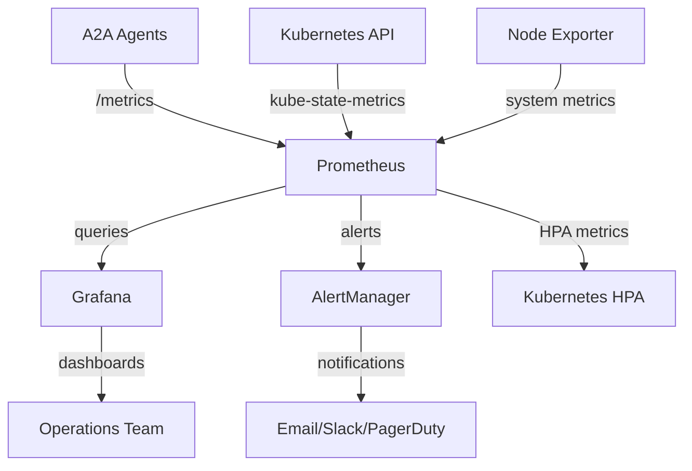

# 📊 Monitoring & Observability - Deep Dive Guide

## Table of Contents
1. [Observability Architecture](#observability-architecture)
2. [Prometheus Monitoring Stack](#prometheus-monitoring-stack)
3. [Custom A2A Metrics](#custom-a2a-metrics)
4. [Grafana Dashboards](#grafana-dashboards)
5. [AlertManager Configuration](#alertmanager-configuration)
6. [Performance Monitoring](#performance-monitoring)
7. [Troubleshooting & Debugging](#troubleshooting--debugging)
8. [Interview Questions & Answers](#interview-questions--answers)

---

## Observability Architecture

### Three Pillars of Observability

The system implements comprehensive observability based on the **three pillars**:

```
┌─────────────────────────────────────────────────────────────────────────────────┐
│                         🔍 Observability Architecture                           │
├─────────────────────────────────────────────────────────────────────────────────┤
│  📊 Metrics                │  📝 Logging               │  🔗 Tracing           │
│  (Prometheus)              │  (Structured Logs)       │  (Request Tracing)    │
│                           │                           │                        │
│  • A2A Protocol Metrics   │  • Agent Request Logs     │  • Request Flow       │
│  • System Metrics         │  • Error Logs             │  • Performance Trace  │
│  • Custom Business Logic  │  • Audit Logs             │  • Dependency Map     │
│  • Autoscaling Metrics    │  • Security Logs          │  • Latency Analysis   │
├─────────────────────────────────────────────────────────────────────────────────┤
│                           📈 Visualization Layer                               │
│  Grafana Dashboards | Real-time Alerting | Performance Analysis | SLA Tracking│
└─────────────────────────────────────────────────────────────────────────────────┘
```

### Monitoring Stack Components

| Component | Purpose | Technology | High Availability |
|-----------|---------|------------|-------------------|
| **Prometheus** | Metrics collection & storage | Time-series DB | Single instance + backup |
| **Grafana** | Visualization & dashboards | Web UI | Single instance + persistence |
| **AlertManager** | Alert routing & notification | Alert processor | Single instance + config |
| **Node Exporter** | System metrics | Host agent | DaemonSet on all nodes |
| **Kube State Metrics** | K8s object metrics | K8s agent | Single instance |

### Data Flow Architecture



---

## Prometheus Monitoring Stack

### 1. **Prometheus Configuration**

#### **Core Configuration**
```yaml
global:
  scrape_interval: 15s       # Collect metrics every 15 seconds
  evaluation_interval: 15s   # Evaluate rules every 15 seconds

rule_files:
  - "alert_rules.yml"        # Alert rule definitions

alerting:
  alertmanagers:
    - static_configs:
        - targets:
          - alertmanager:9093

scrape_configs:
  # A2A Agent monitoring
  - job_name: 'a2a-agents'
    kubernetes_sd_configs:
      - role: pod
        namespaces:
          names:
          - multi-agent-a2a
    relabel_configs:
      - source_labels: [__meta_kubernetes_pod_annotation_prometheus_io_scrape]
        action: keep
        regex: true
      - source_labels: [__meta_kubernetes_pod_annotation_prometheus_io_path]
        action: replace
        target_label: __metrics_path__
        regex: (.+)
```

#### **Agent Discovery & Scraping**
```yaml
# Automatic agent discovery via annotations
annotations:
  prometheus.io/scrape: "true"
  prometheus.io/port: "8080"
  prometheus.io/path: "/metrics"
```

### 2. **Service Discovery Configuration**

#### **Kubernetes Service Discovery**
```yaml
# Kubernetes Nodes (kubelet) monitoring
- job_name: 'kubernetes-nodes'
  kubernetes_sd_configs:
    - role: node
  scheme: https
  tls_config:
    ca_file: /var/run/secrets/kubernetes.io/serviceaccount/ca.crt
  bearer_token_file: /var/run/secrets/kubernetes.io/serviceaccount/token

# Kubernetes Pods (application) monitoring
- job_name: 'kubernetes-pods'
  kubernetes_sd_configs:
    - role: pod
  relabel_configs:
    - source_labels: [__meta_kubernetes_pod_annotation_prometheus_io_scrape]
      action: keep
      regex: true
```

### 3. **RBAC Configuration**

#### **Prometheus ServiceAccount & Permissions**
```yaml
apiVersion: v1
kind: ServiceAccount
metadata:
  name: prometheus
  namespace: multi-agent-a2a
---
apiVersion: rbac.authorization.k8s.io/v1
kind: ClusterRole
metadata:
  name: prometheus
rules:
- apiGroups: [""]
  resources:
  - nodes
  - nodes/proxy
  - services
  - endpoints
  - pods
  verbs: ["get", "list", "watch"]
- apiGroups:
  - extensions
  resources:
  - ingresses
  verbs: ["get", "list", "watch"]
```

---

## Custom A2A Metrics

### 1. **A2A Protocol Metrics**

The system exposes custom metrics specific to A2A protocol monitoring:

```python
class A2AMetrics:
    """Custom A2A protocol metrics for monitoring and autoscaling."""
    
    def __init__(self, agent_name: str, metrics_port: int = 8080):
        self.agent_name = agent_name
        
        # Request metrics
        self.requests_total = Counter(
            'a2a_requests_total',
            'Total number of A2A requests',
            ['agent', 'skill', 'status']
        )
        
        self.request_duration = Histogram(
            'a2a_request_duration_seconds',
            'Duration of A2A request processing',
            ['agent', 'skill'],
            buckets=(0.01, 0.05, 0.1, 0.25, 0.5, 1.0, 2.5, 5.0, 10.0, float('inf'))
        )
        
        # Autoscaling metrics
        self.requests_per_second = Gauge(
            'a2a_requests_per_second',
            'Current requests per second for HPA scaling',
            ['agent']
        )
        
        self.active_tasks = Gauge(
            'a2a_active_tasks',
            'Currently active A2A tasks',
            ['agent']
        )
        
        self.queue_depth = Gauge(
            'a2a_queue_depth',
            'Number of pending tasks in queue',
            ['agent']
        )
        
        # Quality metrics
        self.error_rate = Gauge(
            'a2a_error_rate',
            'Error rate for quality monitoring',
            ['agent', 'error_type']
        )
        
        self.response_quality_score = Histogram(
            'a2a_response_quality_score',
            'Response quality score (0-1)',
            ['agent', 'skill']
        )
```

### 2. **Business Logic Metrics**

#### **Agent-Specific Metrics**
```python
# Calculator Agent specific metrics
calculator_computations_total = Counter(
    'calculator_computations_total',
    'Total mathematical computations performed',
    ['operation_type', 'complexity']
)

# Weather Agent specific metrics  
weather_api_calls_total = Counter(
    'weather_api_calls_total',
    'Total weather API calls',
    ['location', 'forecast_type']
)

# Research Agent specific metrics
research_queries_total = Counter(
    'research_queries_total', 
    'Total research queries processed',
    ['query_type', 'source']
)

# Infrastructure Monitor specific metrics
infrastructure_alerts_total = Counter(
    'infrastructure_alerts_total',
    'Total infrastructure alerts generated',
    ['severity', 'component']
)
```

### 3. **Performance Metrics**

#### **System Performance Indicators**
```python
class PerformanceMetrics:
    def __init__(self):
        # Response time metrics
        self.response_time_p50 = Gauge(
            'a2a_response_time_p50_seconds',
            '50th percentile response time',
            ['agent']
        )
        
        self.response_time_p95 = Gauge(
            'a2a_response_time_p95_seconds', 
            '95th percentile response time',
            ['agent']
        )
        
        self.response_time_p99 = Gauge(
            'a2a_response_time_p99_seconds',
            '99th percentile response time', 
            ['agent']
        )
        
        # Throughput metrics
        self.throughput_rps = Gauge(
            'a2a_throughput_requests_per_second',
            'Request throughput per second',
            ['agent']
        )
        
        # Resource utilization
        self.cpu_utilization = Gauge(
            'a2a_agent_cpu_utilization_percent',
            'Agent CPU utilization percentage',
            ['agent']
        )
        
        self.memory_utilization = Gauge(
            'a2a_agent_memory_utilization_percent',
            'Agent memory utilization percentage', 
            ['agent']
        )
```

### 4. **Metrics Collection Implementation**

#### **Metrics Middleware**
```python
class MetricsMiddleware:
    def __init__(self, metrics: A2AMetrics):
        self.metrics = metrics
    
    async def track_request(self, agent_name: str, skill: str, func):
        """Track request metrics around function execution."""
        start_time = time.time()
        
        try:
            # Execute function
            result = await func()
            
            # Record success metrics
            duration = time.time() - start_time
            self.metrics.requests_total.labels(
                agent=agent_name, 
                skill=skill, 
                status='success'
            ).inc()
            
            self.metrics.request_duration.labels(
                agent=agent_name,
                skill=skill
            ).observe(duration)
            
            return result
            
        except Exception as e:
            # Record error metrics
            self.metrics.requests_total.labels(
                agent=agent_name,
                skill=skill,
                status='error'
            ).inc()
            
            self.metrics.error_rate.labels(
                agent=agent_name,
                error_type=type(e).__name__
            ).inc()
            
            raise e
```

---

## Grafana Dashboards

### 1. **A2A System Overview Dashboard**

#### **Dashboard Layout**
```json
{
  "dashboard": {
    "title": "A2A Multi-Agent System Overview",
    "panels": [
      {
        "title": "System Health Status",
        "type": "stat",
        "targets": [
          {
            "expr": "up{job='a2a-agents'}",
            "legendFormat": "{{agent}} Health"
          }
        ]
      },
      {
        "title": "Request Rate by Agent",
        "type": "graph", 
        "targets": [
          {
            "expr": "rate(a2a_requests_total[5m])",
            "legendFormat": "{{agent}} RPS"
          }
        ]
      },
      {
        "title": "Response Time Distribution",
        "type": "heatmap",
        "targets": [
          {
            "expr": "rate(a2a_request_duration_seconds_bucket[5m])",
            "legendFormat": "{{agent}}"
          }
        ]
      }
    ]
  }
}
```

### 2. **Agent Performance Dashboard**

#### **Key Performance Indicators**
```json
{
  "panels": [
    {
      "title": "Request Throughput",
      "type": "graph",
      "targets": [
        {
          "expr": "sum(rate(a2a_requests_total[5m])) by (agent)",
          "legendFormat": "{{agent}} RPS"
        }
      ]
    },
    {
      "title": "Response Time Percentiles", 
      "type": "graph",
      "targets": [
        {
          "expr": "histogram_quantile(0.50, sum(rate(a2a_request_duration_seconds_bucket[5m])) by (le, agent))",
          "legendFormat": "{{agent}} P50"
        },
        {
          "expr": "histogram_quantile(0.95, sum(rate(a2a_request_duration_seconds_bucket[5m])) by (le, agent))",
          "legendFormat": "{{agent}} P95" 
        }
      ]
    },
    {
      "title": "Error Rate",
      "type": "graph",
      "targets": [
        {
          "expr": "rate(a2a_requests_total{status='error'}[5m]) / rate(a2a_requests_total[5m])",
          "legendFormat": "{{agent}} Error Rate"
        }
      ]
    }
  ]
}
```

### 3. **Autoscaling Dashboard**

#### **HPA Monitoring**
```json
{
  "panels": [
    {
      "title": "Current vs Desired Replicas",
      "type": "graph", 
      "targets": [
        {
          "expr": "kube_hpa_status_current_replicas",
          "legendFormat": "{{hpa}} Current"
        },
        {
          "expr": "kube_hpa_status_desired_replicas", 
          "legendFormat": "{{hpa}} Desired"
        }
      ]
    },
    {
      "title": "Scaling Triggers",
      "type": "graph",
      "targets": [
        {
          "expr": "kube_hpa_status_current_metrics_average_utilization",
          "legendFormat": "{{hpa}} {{metric_name}} Utilization"
        }
      ]
    },
    {
      "title": "A2A Custom Metrics",
      "type": "graph",
      "targets": [
        {
          "expr": "a2a_requests_per_second",
          "legendFormat": "{{agent}} RPS"
        },
        {
          "expr": "a2a_active_tasks",
          "legendFormat": "{{agent}} Active Tasks"
        }
      ]
    }
  ]
}
```

### 4. **Infrastructure Dashboard**

#### **Kubernetes Cluster Monitoring**
```json
{
  "panels": [
    {
      "title": "Pod Resource Usage",
      "type": "graph",
      "targets": [
        {
          "expr": "rate(container_cpu_usage_seconds_total{namespace='multi-agent-a2a'}[5m])",
          "legendFormat": "{{pod}} CPU"
        },
        {
          "expr": "container_memory_usage_bytes{namespace='multi-agent-a2a'}",
          "legendFormat": "{{pod}} Memory"
        }
      ]
    },
    {
      "title": "Network I/O",
      "type": "graph", 
      "targets": [
        {
          "expr": "rate(container_network_receive_bytes_total{namespace='multi-agent-a2a'}[5m])",
          "legendFormat": "{{pod}} RX"
        },
        {
          "expr": "rate(container_network_transmit_bytes_total{namespace='multi-agent-a2a'}[5m])",
          "legendFormat": "{{pod}} TX"
        }
      ]
    }
  ]
}
```

---

## AlertManager Configuration

### 1. **Alert Rules Definition**

#### **A2A System Alerts**
```yaml
groups:
- name: a2a-system-alerts
  rules:
  # High error rate alert
  - alert: HighErrorRate
    expr: |
      (
        rate(a2a_requests_total{status="error"}[5m]) / 
        rate(a2a_requests_total[5m])
      ) > 0.05
    for: 2m
    labels:
      severity: warning
      component: a2a-agent
    annotations:
      summary: "High error rate detected for {{$labels.agent}}"
      description: "Agent {{$labels.agent}} has error rate of {{$value}} for 2 minutes"

  # High response time alert  
  - alert: HighResponseTime
    expr: |
      histogram_quantile(0.95, 
        sum(rate(a2a_request_duration_seconds_bucket[5m])) by (le, agent)
      ) > 2.0
    for: 5m
    labels:
      severity: warning
      component: a2a-agent
    annotations:
      summary: "High response time for {{$labels.agent}}"
      description: "95th percentile response time is {{$value}}s for {{$labels.agent}}"

  # Agent down alert
  - alert: AgentDown
    expr: up{job="a2a-agents"} == 0
    for: 1m
    labels:
      severity: critical
      component: a2a-agent
    annotations:
      summary: "A2A Agent is down"
      description: "Agent {{$labels.instance}} has been down for 1 minute"
```

#### **Autoscaling Alerts**
```yaml
- name: autoscaling-alerts
  rules:
  # HPA at maximum replicas
  - alert: HPAMaxReplicas
    expr: |
      kube_hpa_status_current_replicas == kube_hpa_spec_max_replicas
    for: 5m
    labels:
      severity: warning
      component: autoscaling
    annotations:
      summary: "HPA {{$labels.hpa}} at maximum replicas"
      description: "HPA has been at maximum replicas for 5 minutes"

  # Scaling thrashing detection
  - alert: HPAScalingThrashing
    expr: |
      changes(kube_hpa_status_current_replicas[10m]) > 4
    for: 0m
    labels:
      severity: warning  
      component: autoscaling
    annotations:
      summary: "HPA scaling thrashing detected"
      description: "HPA {{$labels.hpa}} has scaled {{$value}} times in 10 minutes"
```

### 2. **AlertManager Routing**

#### **Alert Routing Configuration**
```yaml
global:
  smtp_smarthost: 'localhost:587'
  smtp_from: 'alerts@a2a-system.local'

route:
  group_by: ['alertname', 'component']
  group_wait: 10s
  group_interval: 10s
  repeat_interval: 1h
  receiver: 'default'
  routes:
  - match:
      severity: critical
    receiver: 'critical-alerts'
  - match:
      component: autoscaling
    receiver: 'autoscaling-team'
  - match:
      component: a2a-agent
    receiver: 'a2a-team'

receivers:
- name: 'default'
  email_configs:
  - to: 'ops-team@company.com'
    subject: 'A2A System Alert: {{.GroupLabels.alertname}}'
    body: |
      {{range .Alerts}}
      Alert: {{.Annotations.summary}}
      Description: {{.Annotations.description}}
      {{end}}

- name: 'critical-alerts'
  email_configs:
  - to: 'oncall@company.com'
    subject: 'CRITICAL: A2A System Alert'
  slack_configs:
  - api_url: 'YOUR_SLACK_WEBHOOK_URL'
    channel: '#critical-alerts'
    title: 'Critical A2A Alert'
    text: '{{.CommonAnnotations.summary}}'
```

### 3. **Alert Severity Levels**

| Severity | Response Time | Examples | Actions |
|----------|---------------|----------|---------|
| **Critical** | Immediate | Service down, data loss | Page on-call, immediate response |
| **Warning** | 15 minutes | High error rate, performance degradation | Email notification, investigate |
| **Info** | 1 hour | Scaling events, configuration changes | Log for analysis |

---

## Performance Monitoring

### 1. **SLA Monitoring**

#### **Service Level Objectives**
```yaml
SLOs:
  availability:
    target: 99.9%
    measurement: up{job="a2a-agents"}
  
  response_time:
    target: 95% of requests < 500ms
    measurement: |
      histogram_quantile(0.95, 
        sum(rate(a2a_request_duration_seconds_bucket[5m])) by (le)
      ) < 0.5
  
  error_rate:
    target: < 0.1%
    measurement: |
      rate(a2a_requests_total{status="error"}[5m]) / 
      rate(a2a_requests_total[5m]) < 0.001

  throughput:
    target: > 1000 RPS system-wide
    measurement: sum(rate(a2a_requests_total[5m])) > 1000
```

#### **SLA Dashboard Queries**
```promql
# Availability calculation
avg_over_time(up{job="a2a-agents"}[30d]) * 100

# Error budget remaining
(1 - (
  rate(a2a_requests_total{status="error"}[30d]) / 
  rate(a2a_requests_total[30d])
)) * 100

# Response time SLA compliance
(
  sum(rate(a2a_request_duration_seconds_bucket{le="0.5"}[5m])) /
  sum(rate(a2a_request_duration_seconds_count[5m]))
) * 100
```

### 2. **Capacity Planning**

#### **Resource Utilization Trends**
```promql
# CPU utilization trend
avg_over_time(
  rate(container_cpu_usage_seconds_total{namespace="multi-agent-a2a"}[5m])[7d:]
)

# Memory utilization trend
avg_over_time(
  container_memory_usage_bytes{namespace="multi-agent-a2a"}[7d:]
)

# Request growth trend
rate(a2a_requests_total[1h])
```

#### **Forecasting Queries**
```promql
# Predict CPU usage in 24 hours
predict_linear(
  avg_over_time(rate(container_cpu_usage_seconds_total[1h])[24h:]), 
  24*3600
)

# Predict request volume growth
predict_linear(
  avg_over_time(rate(a2a_requests_total[1h])[7d:]),
  7*24*3600
)
```

---

## Troubleshooting & Debugging

### 1. **Debugging Workflow**

#### **Issue Investigation Process**
```
1. Alert Detection
   ↓
2. Dashboard Review
   ↓
3. Metrics Analysis
   ↓
4. Log Correlation
   ↓
5. Trace Analysis
   ↓
6. Root Cause Identification
   ↓
7. Resolution & Prevention
```

#### **Common Debugging Queries**

##### **High Error Rate Investigation**
```promql
# Error rate by agent and skill
rate(a2a_requests_total{status="error"}[5m]) by (agent, skill)

# Error types distribution
increase(a2a_requests_total{status="error"}[1h]) by (agent, error_type)

# Recent error spikes
delta(a2a_requests_total{status="error"}[10m])
```

##### **Performance Issues**
```promql
# Slow requests identification
histogram_quantile(0.99, 
  sum(rate(a2a_request_duration_seconds_bucket[5m])) by (le, agent)
)

# Request latency heatmap
rate(a2a_request_duration_seconds_bucket[5m]) by (le, agent)

# Queue depth analysis
a2a_queue_depth > 10
```

##### **Resource Exhaustion**
```promql
# Memory pressure
(container_memory_usage_bytes / container_spec_memory_limit_bytes) > 0.9

# CPU throttling
rate(container_cpu_cfs_throttled_seconds_total[5m]) > 0

# Disk space issues  
(node_filesystem_avail_bytes / node_filesystem_size_bytes) < 0.1
```

### 2. **Performance Analysis Tools**

#### **Request Flow Analysis**
```python
class RequestTracer:
    def trace_request(self, request_id: str) -> Dict[str, Any]:
        """Trace a request across the entire system."""
        
        # Find request in logs
        log_entries = self.search_logs({
            "request_id": request_id,
            "timestamp": {"gte": "now-1h"}
        })
        
        # Extract timing information
        timeline = []
        for entry in log_entries:
            timeline.append({
                "timestamp": entry["timestamp"],
                "component": entry["component"],
                "operation": entry["operation"], 
                "duration": entry.get("duration"),
                "status": entry.get("status")
            })
        
        # Calculate metrics
        total_duration = timeline[-1]["timestamp"] - timeline[0]["timestamp"]
        
        return {
            "request_id": request_id,
            "total_duration": total_duration,
            "timeline": timeline,
            "bottlenecks": self.identify_bottlenecks(timeline)
        }
```

---

## Interview Questions & Answers

### **Observability Strategy Questions**

#### **Q: Describe your monitoring and observability strategy for this distributed system.**

**A:** Our observability strategy implements the **three pillars** with AI Ops focus:

**Metrics (Prometheus)**:
- **25+ custom A2A metrics** for protocol-specific monitoring
- **System metrics** (CPU, memory, network) via Node Exporter
- **Kubernetes metrics** via kube-state-metrics  
- **Custom business metrics** for each agent type

**Logging (Structured)**:
- **Request correlation** with unique IDs across agents
- **Error tracking** with stack traces and context
- **Audit trails** for security and compliance
- **Performance logs** for optimization insights

**Tracing (Request Flow)**:
- **Distributed tracing** across agent communications
- **A2A protocol tracing** for message flow analysis
- **Performance bottleneck** identification
- **Dependency mapping** for system understanding

**Example Metrics**:
```python
a2a_requests_per_second      # For HPA autoscaling
a2a_request_duration_seconds # For SLA monitoring  
a2a_error_rate              # For quality tracking
a2a_active_tasks            # For capacity planning
```

#### **Q: How do you implement effective alerting without alert fatigue?**

**A:** We implement **intelligent alerting** with multiple strategies:

**Alert Severity Levels**:
- **Critical**: Immediate page (service down, data loss)
- **Warning**: 15-minute response (performance degradation)
- **Info**: Log only (scaling events, config changes)

**Alert Routing**:
```yaml
# Route by severity and component
routes:
- match: {severity: critical}
  receiver: 'oncall-pager'
- match: {component: autoscaling}  
  receiver: 'infrastructure-team'
```

**Alert Fatigue Prevention**:
1. **Grouping**: Related alerts grouped together
2. **Suppression**: Dependent alerts suppressed during incidents
3. **Escalation**: Automatic escalation if not acknowledged
4. **Runbooks**: Every alert has clear response procedures

### **Custom Metrics Questions**

#### **Q: What custom metrics do you expose for A2A protocol monitoring?**

**A:** We expose **A2A-specific metrics** for comprehensive monitoring:

**Protocol Metrics**:
- `a2a_requests_total{agent, skill, status}` - Request volume and success rate
- `a2a_request_duration_seconds{agent, skill}` - Response time distribution
- `a2a_active_tasks{agent}` - Current workload for scaling
- `a2a_queue_depth{agent}` - Pending tasks for capacity planning

**Autoscaling Metrics**:
- `a2a_requests_per_second{agent}` - HPA scaling trigger
- `a2a_response_time_p95{agent}` - Quality-based scaling
- `a2a_error_rate{agent}` - Health-based scaling decisions

**Business Metrics**:
- `calculator_computations_total{operation_type}` - Domain-specific tracking
- `weather_api_calls_total{location}` - External dependency monitoring
- `research_queries_total{query_type}` - Workload characterization

**Implementation**:
```python
@metrics.track_request_duration("skill_name")
async def handle_request(self, message: Message) -> Any:
    # Request processing with automatic metrics collection
    pass
```

#### **Q: How do you correlate metrics with system performance and business outcomes?**

**A:** We implement **multi-dimensional correlation**:

**Performance Correlation**:
1. **Response Time vs Resource Usage**: CPU/memory correlation with latency
2. **Error Rate vs System Load**: Identify capacity thresholds
3. **Throughput vs Scaling Events**: Validate autoscaling effectiveness

**Business Correlation**:
- **User Satisfaction vs Technical Metrics**: Response time impact on UX
- **Cost vs Performance**: Resource usage efficiency analysis
- **Feature Usage vs Infrastructure Load**: Capacity planning insights

**Example Analysis**:
```promql
# Correlate response time with CPU usage
a2a_request_duration_seconds_bucket and on(instance) 
rate(container_cpu_usage_seconds_total[5m])

# Business metric correlation
rate(a2a_requests_total[5m]) / 
rate(container_cpu_usage_seconds_total[5m])
```

### **Dashboard Design Questions**

#### **Q: How do you design effective dashboards for different stakeholders?**

**A:** We create **role-specific dashboards** with appropriate abstractions:

**Executive Dashboard**:
- **SLA Compliance**: 99.9% uptime, <500ms response time
- **Business Metrics**: Request volume growth, user satisfaction
- **Cost Efficiency**: Resource utilization vs business value
- **Trend Analysis**: Month-over-month performance

**Operations Dashboard**:
- **System Health**: Real-time status of all components
- **Performance Metrics**: Response time, error rate, throughput
- **Autoscaling Status**: Current vs desired replicas, scaling triggers
- **Alert Summary**: Active alerts and their status

**Development Dashboard**:
- **Code Metrics**: Deployment frequency, lead time, failure rate
- **Performance Profiling**: Request latency breakdown by component
- **Error Analysis**: Error trends, stack traces, resolution time
- **Feature Usage**: A2A skill utilization patterns

**Dashboard Design Principles**:
1. **Progressive Disclosure**: Summary → Details → Root Cause
2. **Context Preservation**: Related metrics grouped together
3. **Actionable Information**: Clear next steps for issues
4. **Mobile Responsive**: Critical metrics accessible on mobile

### **Troubleshooting Questions**

#### **Q: Walk me through your troubleshooting process for a performance issue.**

**A:** Our **systematic troubleshooting process**:

**1. Initial Assessment** (1-2 minutes):
```promql
# Check overall system health
up{job="a2a-agents"}

# Identify affected components
rate(a2a_requests_total{status="error"}[5m]) by (agent)
```

**2. Scope Identification** (2-5 minutes):
- **Time Range**: When did the issue start?
- **Component Impact**: Which agents/services affected?
- **User Impact**: How many users experiencing issues?

**3. Metrics Analysis** (5-10 minutes):
```promql
# Performance degradation analysis
histogram_quantile(0.95, 
  rate(a2a_request_duration_seconds_bucket[5m])
) by (agent)

# Resource constraint identification
rate(container_cpu_usage_seconds_total[5m]) > 0.8
```

**4. Log Correlation** (5-15 minutes):
- **Error Messages**: What errors are occurring?
- **Request Tracing**: Follow request path through system
- **Timing Analysis**: Where are delays occurring?

**5. Root Cause** (10-30 minutes):
- **Dependency Analysis**: External service issues?
- **Resource Analysis**: Memory leaks, CPU bottlenecks?
- **Configuration Issues**: Recent changes or deployments?

**6. Resolution & Prevention**:
- **Immediate Fix**: Scale resources, restart services
- **Long-term Fix**: Code changes, configuration updates
- **Prevention**: Alerts, monitoring improvements

---

## Summary

This monitoring and observability implementation demonstrates enterprise-grade practices:

- **Comprehensive Metrics**: 25+ custom A2A metrics for protocol-specific monitoring
- **Intelligent Alerting**: Severity-based routing with fatigue prevention
- **Multi-Stakeholder Dashboards**: Role-specific views with actionable insights
- **Systematic Troubleshooting**: Structured approach to issue resolution
- **SLA Monitoring**: 99.9% uptime with automated tracking

The system provides complete visibility into A2A protocol operations, enabling proactive issue detection and rapid resolution.

---

*Continue to the next guide for comprehensive testing and validation strategies.*