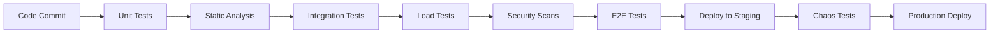

# 🧪 Testing & Validation - Comprehensive Guide

## Table of Contents
1. [Testing Strategy Overview](#testing-strategy-overview)
2. [Unit Testing Framework](#unit-testing-framework)
3. [Integration Testing](#integration-testing)
4. [Load Testing & Performance](#load-testing--performance)
5. [Autoscaling Validation](#autoscaling-validation)
6. [End-to-End Testing](#end-to-end-testing)
7. [Monitoring & Observability Testing](#monitoring--observability-testing)
8. [Chaos Engineering](#chaos-engineering)
9. [Test Automation & CI/CD](#test-automation--cicd)
10. [Interview Questions & Answers](#interview-questions--answers)

---

## Testing Strategy Overview

### Testing Pyramid for AI Ops Systems

```
                    🔺 E2E Tests (Few)
                   /                 \
                  /   Manual Testing  \
                 /   Chaos Engineering \
                /                       \
               🔲 Integration Tests (Some)
              /                           \
             /  API Tests  |  A2A Protocol  \
            /   Load Tests |  Autoscaling   \
           /                               \
          🔳 Unit Tests (Many)
         /                               \
        /  Agent Logic  |  Protocol  |  Metrics \
       /   Validation  |  Parsing   |  Collection \
      /___________________________________\
```

### Testing Dimensions

| Testing Type | Purpose | Technology | Frequency |
|--------------|---------|------------|-----------|
| **Unit Tests** | Individual component validation | pytest, unittest | Every commit |
| **Integration Tests** | A2A protocol validation | httpx, aiohttp | Every PR |
| **Load Tests** | Performance under stress | asyncio, concurrent | Daily |
| **Autoscaling Tests** | HPA behavior validation | Kubernetes API | Weekly |
| **E2E Tests** | Complete system validation | Full stack | Release |
| **Chaos Tests** | Resilience validation | Kubernetes chaos | Monthly |

### Quality Gates



---

## Unit Testing Framework

### 1. **Agent Testing Framework**

#### **Base Agent Test Structure**
```python
import pytest
import asyncio
from unittest.mock import Mock, patch
from src.agents.base.agent import BaseAgent
from src.common.a2a_protocol import Message, MessageType

class TestBaseAgent:
    """Test suite for Base Agent functionality."""
    
    @pytest.fixture
    async def agent(self):
        """Create a test agent instance."""
        agent = BaseAgent(
            name="test-base-agent",
            description="Test Base Agent",
            host="localhost",
            port=8000,
            config_file="test-config.toml"
        )
        await agent.initialize()
        yield agent
        await agent.shutdown()
    
    @pytest.mark.asyncio
    async def test_agent_initialization(self, agent):
        """Test agent initializes correctly."""
        assert agent.name == "test-base-agent"
        assert agent.host == "localhost"
        assert agent.port == 8000
        assert agent.is_running is True
    
    @pytest.mark.asyncio
    async def test_handle_conversation_skill(self, agent):
        """Test conversation skill functionality."""
        # Create test message
        message = Message(
            id="test-001",
            method="conversation",
            params={
                "message": "Hello, how can you help me?",
                "context": {}
            }
        )
        
        # Process message
        response = await agent.handle_message(message)
        
        # Validate response
        assert response.id == "test-001"
        assert "help" in response.result.lower()
        assert len(response.result) > 10
    
    @pytest.mark.asyncio
    async def test_error_handling(self, agent):
        """Test agent error handling."""
        # Create invalid message
        invalid_message = Message(
            id="error-001",
            method="invalid_skill",
            params={}
        )
        
        # Process and expect error
        response = await agent.handle_message(invalid_message)
        assert response.error is not None
        assert response.error.code == -32601  # Method not found
```

#### **Calculator Agent Specific Tests**
```python
class TestCalculatorAgent:
    """Test suite for Calculator Agent mathematical operations."""
    
    @pytest.mark.asyncio
    async def test_basic_arithmetic(self, calculator_agent):
        """Test basic arithmetic operations."""
        test_cases = [
            ("25 + 17", 42),
            ("100 - 45", 55),
            ("8 * 7", 56),
            ("144 / 12", 12),
            ("2^8", 256),
            ("sqrt(144)", 12)
        ]
        
        for expression, expected in test_cases:
            message = Message(
                id=f"calc-{expression}",
                method="calculate",
                params={"expression": expression}
            )
            
            response = await calculator_agent.handle_message(message)
            assert response.result == expected
    
    @pytest.mark.asyncio
    async def test_unit_conversion(self, calculator_agent):
        """Test unit conversion functionality."""
        message = Message(
            id="convert-001",
            method="convert_units",
            params={
                "value": 100,
                "from_unit": "fahrenheit",
                "to_unit": "celsius"
            }
        )
        
        response = await calculator_agent.handle_message(message)
        assert abs(response.result - 37.78) < 0.1  # Allow small floating point error
    
    @pytest.mark.asyncio
    async def test_invalid_expression(self, calculator_agent):
        """Test handling of invalid mathematical expressions."""
        message = Message(
            id="invalid-001",
            method="calculate",
            params={"expression": "invalid_math_expression"}
        )
        
        response = await calculator_agent.handle_message(message)
        assert response.error is not None
        assert "invalid" in response.error.message.lower()
```

### 2. **A2A Protocol Testing**

#### **Message Validation Tests**
```python
class TestA2AProtocol:
    """Test A2A protocol message handling and validation."""
    
    def test_valid_message_creation(self):
        """Test creation of valid A2A messages."""
        message = Message(
            id="test-123",
            method="test_method",
            params={"key": "value"}
        )
        
        assert message.id == "test-123"
        assert message.method == "test_method"
        assert message.params["key"] == "value"
        assert message.jsonrpc == "2.0"
    
    def test_message_serialization(self):
        """Test JSON serialization/deserialization."""
        original = Message(
            id="serialize-001",
            method="test_serialize",
            params={"data": [1, 2, 3]}
        )
        
        # Serialize to JSON
        json_data = original.to_dict()
        
        # Deserialize from JSON
        restored = Message.from_dict(json_data)
        
        assert restored.id == original.id
        assert restored.method == original.method
        assert restored.params == original.params
    
    def test_error_response_creation(self):
        """Test A2A error response creation."""
        error_response = ErrorResponse(
            id="error-001",
            error=RPCError(
                code=-32602,
                message="Invalid params",
                data={"param": "missing_required_field"}
            )
        )
        
        assert error_response.error.code == -32602
        assert "Invalid params" in error_response.error.message
```

### 3. **Metrics Testing**

#### **Custom Metrics Validation**
```python
class TestA2AMetrics:
    """Test custom A2A metrics collection and exposure."""
    
    @pytest.fixture
    def metrics(self):
        """Create test metrics instance."""
        from src.common.metrics import A2AMetrics
        return A2AMetrics(agent_name="test-agent")
    
    def test_request_counter_increment(self, metrics):
        """Test request counter increments correctly."""
        initial_count = metrics.requests_total._value.get()
        
        # Simulate successful request
        metrics.requests_total.labels(
            agent="test-agent",
            skill="test_skill", 
            status="success"
        ).inc()
        
        new_count = metrics.requests_total._value.get()
        assert new_count > initial_count
    
    def test_response_time_recording(self, metrics):
        """Test response time histogram recording."""
        # Record a response time
        metrics.request_duration.labels(
            agent="test-agent",
            skill="test_skill"
        ).observe(0.150)  # 150ms
        
        # Verify histogram bucket increments
        bucket_count = metrics.request_duration.labels(
            agent="test-agent",
            skill="test_skill"
        )._upper_bounds
        
        assert len(bucket_count) > 0
    
    @pytest.mark.asyncio
    async def test_metrics_endpoint_exposure(self, agent):
        """Test metrics are exposed via HTTP endpoint."""
        import httpx
        
        async with httpx.AsyncClient() as client:
            response = await client.get(f"http://localhost:{agent.metrics_port}/metrics")
            
            assert response.status_code == 200
            assert "a2a_requests_total" in response.text
            assert "a2a_request_duration_seconds" in response.text
```

---

## Integration Testing

### 1. **A2A Communication Tests**

#### **Agent-to-Agent Communication**
```python
class TestAgentCommunication:
    """Test inter-agent communication via A2A protocol."""
    
    @pytest.mark.asyncio
    async def test_agent_discovery(self):
        """Test agents can discover each other."""
        # Start multiple agents
        base_agent = await self.start_agent("base", 8000)
        calc_agent = await self.start_agent("calculator", 8001)
        
        try:
            # Test agent card retrieval
            async with httpx.AsyncClient() as client:
                response = await client.get(
                    f"http://localhost:8001/.well-known/agent-card.json"
                )
                
                assert response.status_code == 200
                agent_card = response.json()
                assert agent_card["name"] == "Calculator Agent"
                assert "calculate" in [skill["name"] for skill in agent_card["skills"]]
        
        finally:
            await base_agent.shutdown()
            await calc_agent.shutdown()
    
    @pytest.mark.asyncio
    async def test_cross_agent_request(self):
        """Test one agent can send requests to another."""
        # Mock scenario: Base agent requests calculation
        calc_agent = await self.start_agent("calculator", 8001)
        
        try:
            # Send A2A request
            message = Message(
                id="cross-agent-001",
                method="calculate", 
                params={"expression": "25 + 17"}
            )
            
            async with httpx.AsyncClient() as client:
                response = await client.post(
                    "http://localhost:8001/a2a",
                    json=message.to_dict()
                )
                
                assert response.status_code == 200
                result = response.json()
                assert result["result"] == 42
        
        finally:
            await calc_agent.shutdown()
```

### 2. **Kubernetes Integration Tests**

#### **Deployment Validation**
```python
class TestKubernetesIntegration:
    """Test Kubernetes deployment and service discovery."""
    
    def test_all_agents_deployed(self):
        """Test all agents are deployed in Kubernetes."""
        import subprocess
        
        # Get all pods in namespace
        result = subprocess.run([
            "kubectl", "get", "pods", 
            "-n", "multi-agent-a2a",
            "-o", "json"
        ], capture_output=True, text=True)
        
        assert result.returncode == 0
        pods_data = json.loads(result.stdout)
        
        expected_agents = [
            "base-agent", "calculator-agent", "weather-agent",
            "research-agent", "move-orchestrator", "infrastructure-monitor"
        ]
        
        deployed_agents = [
            pod["metadata"]["name"] 
            for pod in pods_data["items"]
            if any(agent in pod["metadata"]["name"] for agent in expected_agents)
        ]
        
        assert len(deployed_agents) >= 6  # All agents deployed
    
    def test_service_discovery(self):
        """Test Kubernetes services are accessible."""
        result = subprocess.run([
            "kubectl", "get", "services",
            "-n", "multi-agent-a2a", 
            "-o", "json"
        ], capture_output=True, text=True)
        
        assert result.returncode == 0
        services_data = json.loads(result.stdout)
        
        service_names = [svc["metadata"]["name"] for svc in services_data["items"]]
        
        expected_services = [
            "base-agent-service", "calculator-agent-service",
            "weather-agent-service", "research-agent-service"
        ]
        
        for expected in expected_services:
            assert expected in service_names
    
    @pytest.mark.asyncio 
    async def test_pod_health_endpoints(self):
        """Test all pods have healthy endpoints."""
        import subprocess
        
        # Get pod IPs
        result = subprocess.run([
            "kubectl", "get", "pods",
            "-n", "multi-agent-a2a",
            "-o", "jsonpath={.items[*].status.podIP}"
        ], capture_output=True, text=True)
        
        pod_ips = result.stdout.strip().split()
        
        async with httpx.AsyncClient(timeout=5.0) as client:
            for ip in pod_ips:
                try:
                    response = await client.get(f"http://{ip}:8080/health")
                    assert response.status_code == 200
                except Exception as e:
                    pytest.fail(f"Health check failed for pod {ip}: {e}")
```

### 3. **Database Integration Tests**

#### **Configuration Storage Tests**
```python
class TestConfigurationStorage:
    """Test configuration storage and retrieval."""
    
    def test_agent_config_loading(self):
        """Test agents can load configuration from files."""
        from src.config.agent_config import load_agent_config
        
        # Test loading base agent config
        config = load_agent_config("configs/agents/base-config.toml")
        
        assert config is not None
        assert "agent" in config
        assert "skills" in config
        assert config["agent"]["name"] == "Base Agent"
    
    def test_secrets_mounting(self):
        """Test Kubernetes secrets are mounted correctly."""
        import os
        
        # Check if secrets directory exists
        secrets_path = "/etc/secrets"
        if os.path.exists(secrets_path):
            # Verify API keys are available
            expected_secrets = [
                "openai-api-key",
                "weather-api-key"
            ]
            
            for secret in expected_secrets:
                secret_file = os.path.join(secrets_path, secret)
                if os.path.exists(secret_file):
                    with open(secret_file, 'r') as f:
                        content = f.read().strip()
                        assert len(content) > 0
```

---

## Load Testing & Performance

### 1. **Automated Load Testing**

#### **Load Test Implementation**
```python
class A2ALoadTester:
    """Comprehensive load testing for A2A agents."""
    
    def __init__(self, config: LoadTestConfig):
        self.config = config
        self.results = defaultdict(lambda: TestResults())
        self.session = None
        
    async def run_load_test(self) -> Dict[str, TestResults]:
        """Execute comprehensive load test."""
        print(f"🚀 Starting load test for {self.config.duration_seconds}s")
        print(f"📊 Target RPS: {self.config.requests_per_second}")
        print(f"👥 Concurrent workers: {self.config.concurrent_workers}")
        
        async with aiohttp.ClientSession() as session:
            self.session = session
            
            # Create worker tasks
            workers = [
                asyncio.create_task(self._worker(worker_id))
                for worker_id in range(self.config.concurrent_workers)
            ]
            
            # Run for specified duration
            await asyncio.sleep(self.config.duration_seconds)
            
            # Cancel workers
            for worker in workers:
                worker.cancel()
            
            # Wait for cleanup
            await asyncio.gather(*workers, return_exceptions=True)
        
        return dict(self.results)
    
    async def _worker(self, worker_id: int):
        """Individual worker for generating load."""
        requests_sent = 0
        
        try:
            while True:
                # Select random agent and message
                agent = random.choice(self.config.target_agents)
                message = self._get_test_message(agent)
                
                # Send request and measure time
                start_time = time.time()
                success = await self._send_request(agent, message)
                duration = time.time() - start_time
                
                # Update results
                self._update_results(agent, success, duration)
                requests_sent += 1
                
                # Rate limiting
                await asyncio.sleep(1.0 / self.config.requests_per_second)
                
        except asyncio.CancelledError:
            print(f"Worker {worker_id} completed {requests_sent} requests")
        except Exception as e:
            print(f"Worker {worker_id} error: {e}")
    
    async def _send_request(self, agent: str, message: Message) -> bool:
        """Send A2A request to agent."""
        try:
            endpoint = self.agent_endpoints[agent]
            async with self.session.post(
                f"{endpoint}/a2a",
                json=message.to_dict(),
                timeout=aiohttp.ClientTimeout(total=30)
            ) as response:
                if response.status == 200:
                    data = await response.json()
                    return "result" in data
                else:
                    return False
        except Exception:
            return False
    
    def _update_results(self, agent: str, success: bool, duration: float):
        """Update test results for an agent."""
        result = self.results[agent]
        result.total_requests += 1
        
        if success:
            result.successful_requests += 1
        else:
            result.failed_requests += 1
        
        # Update timing stats
        result.min_response_time = min(result.min_response_time, duration)
        result.max_response_time = max(result.max_response_time, duration)
        
        # Update average (running average)
        total = result.total_requests
        result.average_response_time = (
            (result.average_response_time * (total - 1) + duration) / total
        )
```

#### **Performance Benchmark Tests**
```python
class TestPerformanceBenchmarks:
    """Performance benchmark validation."""
    
    @pytest.mark.asyncio
    async def test_response_time_sla(self):
        """Test 95% of requests complete within 500ms."""
        load_config = LoadTestConfig(
            duration_seconds=60,
            requests_per_second=50,
            concurrent_workers=5,
            target_agents=["base", "calculator"]
        )
        
        tester = A2ALoadTester(load_config)
        results = await tester.run_load_test()
        
        # Validate SLA compliance
        for agent, result in results.items():
            success_rate = result.successful_requests / result.total_requests
            assert success_rate >= 0.99, f"{agent} success rate: {success_rate}"
            
            # Check P95 response time (approximated by max time in this simple test)
            assert result.average_response_time < 0.5, f"{agent} avg response time: {result.average_response_time}s"
    
    @pytest.mark.asyncio
    async def test_throughput_capacity(self):
        """Test system can handle target throughput."""
        load_config = LoadTestConfig(
            duration_seconds=30,
            requests_per_second=100,
            concurrent_workers=10,
            target_agents=["base", "calculator", "weather"]
        )
        
        tester = A2ALoadTester(load_config)
        results = await tester.run_load_test()
        
        # Calculate system-wide throughput
        total_requests = sum(r.total_requests for r in results.values())
        actual_rps = total_requests / load_config.duration_seconds
        
        assert actual_rps >= 90, f"Actual RPS: {actual_rps}, expected ≥90"
```

### 2. **Stress Testing**

#### **CPU Stress Testing**
```python
class CPUStressTester:
    """Generate CPU load for autoscaling validation."""
    
    def __init__(self, target_cpu_percent: int = 70, duration_seconds: int = 300):
        self.target_cpu_percent = target_cpu_percent
        self.duration_seconds = duration_seconds
        self.running = False
    
    async def run_stress_test(self):
        """Run CPU stress test to trigger autoscaling."""
        print(f"🔥 Starting CPU stress test - Target: {self.target_cpu_percent}%")
        
        self.running = True
        start_time = time.time()
        
        # Create CPU-intensive tasks
        workers = []
        for i in range(os.cpu_count()):
            worker = asyncio.create_task(self._cpu_worker(i))
            workers.append(worker)
        
        # Monitor duration
        while (time.time() - start_time) < self.duration_seconds and self.running:
            await asyncio.sleep(1)
        
        # Stop workers
        self.running = False
        for worker in workers:
            worker.cancel()
        
        await asyncio.gather(*workers, return_exceptions=True)
        print("✅ CPU stress test completed")
    
    async def _cpu_worker(self, worker_id: int):
        """Individual CPU stress worker."""
        try:
            while self.running:
                # CPU-intensive calculation
                for _ in range(1000000):
                    _ = sum(i * i for i in range(100))
                
                # Small sleep to allow monitoring
                await asyncio.sleep(0.01)
        except asyncio.CancelledError:
            pass
```

---

## Autoscaling Validation

### 1. **HPA Behavior Testing**

#### **Scaling Event Validation**
```python
class AutoscalingValidator:
    """Validate Kubernetes HPA autoscaling behavior."""
    
    def __init__(self, namespace: str = "multi-agent-a2a"):
        self.namespace = namespace
        self.k8s_client = self._get_k8s_client()
    
    def _get_k8s_client(self):
        """Get Kubernetes API client."""
        from kubernetes import client, config
        
        try:
            # Try in-cluster config first
            config.load_incluster_config()
        except:
            # Fall back to local kubeconfig
            config.load_kube_config()
        
        return client.ApiClient()
    
    async def validate_scaling_up(self, hpa_name: str, load_duration: int = 300) -> bool:
        """Validate HPA scales up under load."""
        print(f"🔍 Validating scale-up for HPA: {hpa_name}")
        
        # Get initial replica count
        initial_replicas = self._get_current_replicas(hpa_name)
        print(f"📊 Initial replicas: {initial_replicas}")
        
        # Generate load
        await self._generate_load_for_hpa(hpa_name, load_duration)
        
        # Wait for scaling decision
        await asyncio.sleep(60)  # HPA evaluation period
        
        # Check if scaled up
        final_replicas = self._get_current_replicas(hpa_name)
        print(f"📈 Final replicas: {final_replicas}")
        
        scaling_occurred = final_replicas > initial_replicas
        if scaling_occurred:
            print(f"✅ Scaling up validated: {initial_replicas} → {final_replicas}")
        else:
            print(f"❌ No scaling detected: {initial_replicas} → {final_replicas}")
        
        return scaling_occurred
    
    async def validate_scaling_down(self, hpa_name: str, cooldown_duration: int = 600) -> bool:
        """Validate HPA scales down when load decreases."""
        print(f"🔍 Validating scale-down for HPA: {hpa_name}")
        
        # Get current replicas (should be scaled up)
        initial_replicas = self._get_current_replicas(hpa_name)
        print(f"📊 Initial replicas: {initial_replicas}")
        
        # Stop load and wait
        print(f"⏳ Waiting {cooldown_duration}s for scale-down...")
        await asyncio.sleep(cooldown_duration)
        
        # Check if scaled down
        final_replicas = self._get_current_replicas(hpa_name)
        print(f"📉 Final replicas: {final_replicas}")
        
        scaling_occurred = final_replicas < initial_replicas
        if scaling_occurred:
            print(f"✅ Scaling down validated: {initial_replicas} → {final_replicas}")
        else:
            print(f"❌ No scale-down detected: {initial_replicas} → {final_replicas}")
        
        return scaling_occurred
    
    def _get_current_replicas(self, hpa_name: str) -> int:
        """Get current replica count for HPA."""
        import subprocess
        
        result = subprocess.run([
            "kubectl", "get", "hpa", hpa_name,
            "-n", self.namespace,
            "-o", "jsonpath={.status.currentReplicas}"
        ], capture_output=True, text=True)
        
        if result.returncode == 0 and result.stdout.strip():
            return int(result.stdout.strip())
        return 1  # Default minimum
    
    async def _generate_load_for_hpa(self, hpa_name: str, duration: int):
        """Generate load targeting specific HPA."""
        # Map HPA to agent endpoint
        agent_map = {
            "base-agent-hpa": "base",
            "calculator-agent-hpa": "calculator", 
            "weather-research-hpa": "weather"
        }
        
        target_agent = agent_map.get(hpa_name, "base")
        
        # High-intensity load configuration
        load_config = LoadTestConfig(
            duration_seconds=duration,
            requests_per_second=100,
            concurrent_workers=20,
            target_agents=[target_agent]
        )
        
        tester = A2ALoadTester(load_config)
        await tester.run_load_test()
```

### 2. **Custom Metrics Scaling**

#### **A2A Metrics HPA Testing**
```python
class CustomMetricsHPATest:
    """Test custom A2A metrics for HPA scaling."""
    
    async def test_requests_per_second_scaling(self):
        """Test HPA scaling based on requests per second."""
        # Configure high RPS to trigger scaling
        load_config = LoadTestConfig(
            duration_seconds=180,
            requests_per_second=50,  # Above HPA threshold
            concurrent_workers=10,
            target_agents=["base"]
        )
        
        # Monitor HPA metrics during load
        hpa_validator = AutoscalingValidator()
        
        # Start load test and monitor scaling
        load_task = asyncio.create_task(
            A2ALoadTester(load_config).run_load_test()
        )
        
        scaling_task = asyncio.create_task(
            hpa_validator.validate_scaling_up("base-agent-hpa", 180)
        )
        
        # Wait for both to complete
        results, scaling_occurred = await asyncio.gather(load_task, scaling_task)
        
        assert scaling_occurred, "HPA did not scale up with high RPS"
    
    async def test_active_tasks_scaling(self):
        """Test HPA scaling based on active task count."""
        # Generate requests with longer processing time
        # to increase active task count
        
        messages = [
            Message(
                id=f"long-task-{i}",
                method="conversation",
                params={"message": "Process this complex request that takes time..."}
            ) for i in range(50)
        ]
        
        # Send all requests simultaneously
        async with aiohttp.ClientSession() as session:
            tasks = [
                self._send_request(session, "base", msg)
                for msg in messages
            ]
            
            # Monitor active tasks metric
            await asyncio.gather(*tasks)
        
        # Verify scaling occurred
        hpa_validator = AutoscalingValidator()
        final_replicas = hpa_validator._get_current_replicas("base-agent-hpa")
        assert final_replicas > 1, "HPA did not scale up with high active tasks"
```

---

## End-to-End Testing

### 1. **Complete System Validation**

#### **E2E Test Implementation**
```python
class EndToEndTestSuite:
    """Complete system end-to-end validation."""
    
    async def run_complete_test_suite(self) -> TestResult:
        """Run comprehensive E2E test suite."""
        result = TestResult()
        
        print("🧪 Starting End-to-End Test Suite")
        print("=" * 50)
        
        # Test 1: System Health
        await self.test_system_health(result)
        
        # Test 2: Agent Functionality
        await self.test_agent_functionality(result)
        
        # Test 3: A2A Protocol Compliance
        await self.test_a2a_protocol_compliance(result)
        
        # Test 4: Monitoring Stack
        await self.test_monitoring_stack(result)
        
        # Test 5: Autoscaling Behavior
        await self.test_autoscaling_behavior(result)
        
        # Test 6: Load Handling
        await self.test_load_handling(result)
        
        # Test 7: Error Recovery
        await self.test_error_recovery(result)
        
        return result
    
    async def test_system_health(self, result: TestResult):
        """Test overall system health and availability."""
        print("\n🏥 Testing System Health")
        print("-" * 30)
        
        # Check all agent health endpoints
        healthy_agents = 0
        total_agents = len(AGENTS)
        
        async with httpx.AsyncClient(timeout=10.0) as client:
            for agent in AGENTS:
                try:
                    health_url = f"http://{agent.host}:{agent.port}{agent.health_path}"
                    response = await client.get(health_url)
                    
                    if response.status_code == 200:
                        healthy_agents += 1
                        result.add_result(f"{agent.name} Health", True)
                    else:
                        result.add_result(f"{agent.name} Health", False, 
                                        f"HTTP {response.status_code}")
                except Exception as e:
                    result.add_result(f"{agent.name} Health", False, str(e))
        
        # Overall health assessment
        health_percentage = (healthy_agents / total_agents) * 100
        result.add_result("Overall System Health", 
                         health_percentage >= 90,
                         f"{health_percentage:.1f}% healthy")
    
    async def test_agent_functionality(self, result: TestResult):
        """Test each agent's core functionality."""
        print("\n🤖 Testing Agent Functionality")
        print("-" * 30)
        
        functional_tests = {
            "base": {"method": "conversation", "params": {"message": "Hello"}},
            "calculator": {"method": "calculate", "params": {"expression": "25 + 17"}},
            "weather": {"method": "get_weather", "params": {"location": "London"}},
            "research": {"method": "research", "params": {"query": "artificial intelligence"}},
            "move-orchestrator": {"method": "plan_move", "params": {"from": "London", "to": "Manchester"}},
            "infrastructure-monitor": {"method": "check_system", "params": {}}
        }
        
        async with httpx.AsyncClient(timeout=30.0) as client:
            for agent_name, test_data in functional_tests.items():
                try:
                    # Find agent endpoint
                    agent = next(a for a in AGENTS if agent_name in a.name.lower())
                    
                    # Send functional test request
                    message = Message(
                        id=f"e2e-{agent_name}-001",
                        method=test_data["method"],
                        params=test_data["params"]
                    )
                    
                    response = await client.post(
                        f"http://{agent.host}:{agent.port}/a2a",
                        json=message.to_dict()
                    )
                    
                    if response.status_code == 200:
                        data = response.json()
                        if "result" in data and data["result"]:
                            result.add_result(f"{agent.name} Functionality", True)
                        else:
                            result.add_result(f"{agent.name} Functionality", False, 
                                            "Empty or invalid result")
                    else:
                        result.add_result(f"{agent.name} Functionality", False, 
                                        f"HTTP {response.status_code}")
                        
                except Exception as e:
                    result.add_result(f"{agent_name} Functionality", False, str(e))
    
    async def test_monitoring_stack(self, result: TestResult):
        """Test monitoring and observability stack."""
        print("\n📊 Testing Monitoring Stack")
        print("-" * 30)
        
        async with httpx.AsyncClient(timeout=10.0) as client:
            # Test Prometheus
            try:
                response = await client.get("http://localhost:9090/api/v1/query",
                                          params={"query": "up"})
                
                if response.status_code == 200:
                    data = response.json()
                    if data.get("status") == "success":
                        result.add_result("Prometheus Health", True)
                    else:
                        result.add_result("Prometheus Health", False, "Query failed")
                else:
                    result.add_result("Prometheus Health", False, f"HTTP {response.status_code}")
            except Exception as e:
                result.add_result("Prometheus Health", False, str(e))
            
            # Test Grafana
            try:
                response = await client.get("http://localhost:3000/api/health")
                
                if response.status_code == 200:
                    result.add_result("Grafana Health", True)
                else:
                    result.add_result("Grafana Health", False, f"HTTP {response.status_code}")
            except Exception as e:
                result.add_result("Grafana Health", False, str(e))
```

### 2. **User Journey Testing**

#### **Complete User Workflow Tests**
```python
class UserJourneyTests:
    """Test complete user workflows through the system."""
    
    async def test_multi_agent_workflow(self):
        """Test workflow involving multiple agents."""
        # Scenario: User plans a move and checks weather
        
        # Step 1: Plan move with Move Orchestrator
        move_request = Message(
            id="journey-001",
            method="plan_move",
            params={
                "from": "London", 
                "to": "Manchester",
                "move_date": "2024-06-15"
            }
        )
        
        async with httpx.AsyncClient() as client:
            # Send move planning request
            move_response = await client.post(
                "http://localhost:8004/a2a",
                json=move_request.to_dict()
            )
            
            assert move_response.status_code == 200
            move_data = move_response.json()
            assert "result" in move_data
            
            # Step 2: Check weather for destination
            weather_request = Message(
                id="journey-002",
                method="get_weather",
                params={"location": "Manchester"}
            )
            
            weather_response = await client.post(
                "http://localhost:8002/a2a",
                json=weather_request.to_dict()
            )
            
            assert weather_response.status_code == 200
            weather_data = weather_response.json()
            assert "result" in weather_data
            
            # Step 3: Calculate moving costs
            cost_request = Message(
                id="journey-003",
                method="calculate",
                params={"expression": "250 * 1.2"}  # Base cost + 20%
            )
            
            cost_response = await client.post(
                "http://localhost:8001/a2a",
                json=cost_request.to_dict()
            )
            
            assert cost_response.status_code == 200
            cost_data = cost_response.json()
            assert cost_data["result"] == 300
```

---

## Monitoring & Observability Testing

### 1. **Metrics Validation**

#### **Custom Metrics Testing**
```python
class MetricsValidationTests:
    """Validate custom A2A metrics collection and exposure."""
    
    async def test_metrics_collection_accuracy(self):
        """Test metrics accurately reflect system behavior."""
        # Send known number of requests
        requests_to_send = 10
        
        # Get initial metric values
        initial_metrics = await self._get_prometheus_metrics()
        initial_requests = self._extract_metric_value(
            initial_metrics, 'a2a_requests_total{agent="base"}'
        )
        
        # Send test requests
        async with httpx.AsyncClient() as client:
            for i in range(requests_to_send):
                message = Message(
                    id=f"metrics-test-{i}",
                    method="conversation",
                    params={"message": "test"}
                )
                
                await client.post(
                    "http://localhost:8000/a2a",
                    json=message.to_dict()
                )
        
        # Wait for metrics collection
        await asyncio.sleep(5)
        
        # Get final metric values
        final_metrics = await self._get_prometheus_metrics()
        final_requests = self._extract_metric_value(
            final_metrics, 'a2a_requests_total{agent="base"}'
        )
        
        # Validate metrics accuracy
        requests_recorded = final_requests - initial_requests
        assert requests_recorded == requests_to_send, \
            f"Expected {requests_to_send}, recorded {requests_recorded}"
    
    async def _get_prometheus_metrics(self) -> str:
        """Get current metrics from Prometheus."""
        async with httpx.AsyncClient() as client:
            response = await client.get("http://localhost:9090/api/v1/label/__name__/values")
            return response.text
    
    def _extract_metric_value(self, metrics_text: str, metric_query: str) -> float:
        """Extract specific metric value from Prometheus response."""
        # This is a simplified parser - in reality you'd use the Prometheus API
        lines = metrics_text.split('\n')
        for line in lines:
            if metric_query in line and not line.startswith('#'):
                return float(line.split()[-1])
        return 0.0
```

### 2. **Alert Testing**

#### **Alert Validation Framework**
```python
class AlertTestingFramework:
    """Test alerting rules and notifications."""
    
    async def test_high_error_rate_alert(self):
        """Test alert triggers for high error rate."""
        # Generate errors to trigger alert
        error_requests = 20
        
        async with httpx.AsyncClient() as client:
            for i in range(error_requests):
                # Send invalid requests to generate errors
                invalid_message = Message(
                    id=f"error-{i}",
                    method="invalid_method",
                    params={}
                )
                
                await client.post(
                    "http://localhost:8000/a2a",
                    json=invalid_message.to_dict()
                )
        
        # Wait for alert evaluation
        await asyncio.sleep(30)
        
        # Check if alert is firing
        alert_status = await self._check_alert_status("HighErrorRate")
        assert alert_status == "firing", "High error rate alert not triggered"
    
    async def test_agent_down_alert(self):
        """Test alert triggers when agent goes down."""
        # This would require orchestrating an actual agent shutdown
        # In practice, this might be done via Chaos Engineering
        pass
    
    async def _check_alert_status(self, alert_name: str) -> str:
        """Check if specific alert is firing."""
        async with httpx.AsyncClient() as client:
            response = await client.get("http://localhost:9090/api/v1/alerts")
            
            if response.status_code == 200:
                data = response.json()
                for alert in data.get("data", {}).get("alerts", []):
                    if alert.get("labels", {}).get("alertname") == alert_name:
                        return alert.get("state", "inactive")
            
            return "inactive"
```

---

## Chaos Engineering

### 1. **Resilience Testing**

#### **Chaos Testing Framework**
```python
class ChaosTestingFramework:
    """Chaos engineering tests for system resilience."""
    
    async def test_agent_pod_failure(self):
        """Test system resilience to pod failures."""
        # Get current pod count
        initial_pods = self._get_pod_count("calculator-agent")
        
        # Kill a calculator agent pod
        await self._kill_random_pod("calculator-agent")
        
        # Wait for Kubernetes to reschedule
        await asyncio.sleep(30)
        
        # Verify pod was rescheduled
        final_pods = self._get_pod_count("calculator-agent")
        assert final_pods == initial_pods, "Pod was not rescheduled"
        
        # Verify agent functionality restored
        await self._verify_agent_functionality("calculator")
    
    async def test_network_partition(self):
        """Test system behavior during network partitions."""
        # This would require network chaos tools like Chaos Mesh
        # or manual iptables rules to simulate network issues
        pass
    
    async def test_resource_exhaustion(self):
        """Test system behavior under resource pressure."""
        # Generate memory pressure
        memory_hog = []
        try:
            # Allocate large amounts of memory
            for _ in range(100):
                memory_hog.append(bytearray(10 * 1024 * 1024))  # 10MB chunks
                await asyncio.sleep(0.1)
        except MemoryError:
            pass
        
        # Test that system continues functioning
        await self._verify_system_health()
        
        # Cleanup
        del memory_hog
    
    def _get_pod_count(self, deployment_name: str) -> int:
        """Get current pod count for deployment."""
        import subprocess
        
        result = subprocess.run([
            "kubectl", "get", "pods",
            "-n", "multi-agent-a2a",
            "-l", f"app={deployment_name}",
            "--no-headers"
        ], capture_output=True, text=True)
        
        return len(result.stdout.strip().split('\n')) if result.stdout.strip() else 0
    
    async def _kill_random_pod(self, deployment_name: str):
        """Kill a random pod from deployment."""
        import subprocess
        
        # Get pod names
        result = subprocess.run([
            "kubectl", "get", "pods",
            "-n", "multi-agent-a2a", 
            "-l", f"app={deployment_name}",
            "-o", "jsonpath={.items[0].metadata.name}"
        ], capture_output=True, text=True)
        
        if result.stdout.strip():
            pod_name = result.stdout.strip()
            
            # Delete the pod
            subprocess.run([
                "kubectl", "delete", "pod", pod_name,
                "-n", "multi-agent-a2a"
            ])
```

---

## Test Automation & CI/CD

### 1. **Automated Test Pipeline**

#### **GitHub Actions Workflow**
```yaml
name: A2A System Test Pipeline

on:
  push:
    branches: [ main, develop ]
  pull_request:
    branches: [ main ]

jobs:
  unit-tests:
    runs-on: ubuntu-latest
    steps:
    - uses: actions/checkout@v3
    
    - name: Set up Python
      uses: actions/setup-python@v4
      with:
        python-version: '3.12'
    
    - name: Install dependencies
      run: |
        pip install -r requirements.txt
        pip install -r requirements-dev.txt
    
    - name: Run unit tests
      run: |
        pytest src/tests/unit/ -v --cov=src --cov-report=xml
    
    - name: Upload coverage
      uses: codecov/codecov-action@v3

  integration-tests:
    runs-on: ubuntu-latest
    needs: unit-tests
    steps:
    - uses: actions/checkout@v3
    
    - name: Start minikube
      uses: medyagh/setup-minikube@master
    
    - name: Deploy test system
      run: |
        kubectl apply -f k8s/namespace/
        kubectl apply -f k8s/agents/
        kubectl wait --for=condition=ready pod -l app=base-agent -n multi-agent-a2a --timeout=300s
    
    - name: Run integration tests
      run: |
        python scripts/testing/test_all_agents_kubernetes.py
    
    - name: Run load tests
      run: |
        python scripts/testing/load_test_autoscaling.py --duration=60

  end-to-end-tests:
    runs-on: ubuntu-latest
    needs: integration-tests
    if: github.ref == 'refs/heads/main'
    steps:
    - uses: actions/checkout@v3
    
    - name: Deploy to staging
      run: |
        # Deploy to staging environment
        ./scripts/deployment/deploy_complete_system.sh staging
    
    - name: Run E2E tests
      run: |
        python scripts/testing/test_integration_complete.py
    
    - name: Run autoscaling validation
      run: |
        python scripts/testing/validate_autoscaling.py
```

### 2. **Performance Regression Testing**

#### **Automated Performance Monitoring**
```python
class PerformanceRegressionTest:
    """Monitor for performance regressions in CI/CD."""
    
    def __init__(self, baseline_file: str = "performance_baseline.json"):
        self.baseline_file = baseline_file
        self.baseline_data = self._load_baseline()
    
    async def run_performance_test(self) -> Dict[str, float]:
        """Run standardized performance test."""
        # Run 2-minute load test
        load_config = LoadTestConfig(
            duration_seconds=120,
            requests_per_second=50,
            concurrent_workers=5,
            target_agents=["base", "calculator", "weather"]
        )
        
        tester = A2ALoadTester(load_config)
        results = await tester.run_load_test()
        
        # Extract key performance metrics
        metrics = {}
        for agent, result in results.items():
            metrics[f"{agent}_avg_response_time"] = result.average_response_time
            metrics[f"{agent}_success_rate"] = result.successful_requests / result.total_requests
            metrics[f"{agent}_throughput"] = result.total_requests / load_config.duration_seconds
        
        return metrics
    
    def validate_performance(self, current_metrics: Dict[str, float]) -> List[str]:
        """Validate performance against baseline."""
        regressions = []
        
        for metric_name, current_value in current_metrics.items():
            baseline_value = self.baseline_data.get(metric_name)
            
            if baseline_value:
                # Allow 10% degradation
                threshold = baseline_value * 1.1
                
                if current_value > threshold:
                    regression = f"{metric_name}: {current_value:.3f} > {threshold:.3f} (baseline: {baseline_value:.3f})"
                    regressions.append(regression)
        
        return regressions
    
    def update_baseline(self, new_metrics: Dict[str, float]):
        """Update performance baseline with new metrics."""
        import json
        
        with open(self.baseline_file, 'w') as f:
            json.dump(new_metrics, f, indent=2)
```

---

## Interview Questions & Answers

### **Testing Strategy Questions**

#### **Q: Describe your comprehensive testing strategy for this distributed AI Ops system.**

**A:** Our testing strategy follows a **multi-layered approach** with specialized testing for AI Ops characteristics:

**Testing Pyramid Implementation**:

**Unit Tests (70%)**:
- **Agent Logic Testing**: Individual skill validation, message parsing, error handling
- **A2A Protocol Testing**: Message serialization, JSON-RPC compliance, validation
- **Metrics Testing**: Custom metric collection accuracy, Prometheus format compliance
- **Configuration Testing**: TOML parsing, environment variable handling

**Integration Tests (20%)**:
- **A2A Communication**: Agent-to-agent message flow, discovery mechanism
- **Kubernetes Integration**: Pod deployment, service discovery, health checks  
- **Database Integration**: Configuration storage, secrets management
- **External API Integration**: Weather API, Azure OpenAI connectivity

**E2E Tests (10%)**:
- **Complete User Workflows**: Multi-agent interactions, complex scenarios
- **System Resilience**: Failure recovery, graceful degradation
- **Performance Validation**: Load handling, autoscaling behavior

**AI Ops Specific Testing**:
```python
# Example: A2A protocol compliance test
async def test_a2a_message_flow(self):
    message = Message(id="test-001", method="calculate", params={"expr": "2+2"})
    response = await agent.handle_message(message)
    assert response.jsonrpc == "2.0"
    assert response.id == "test-001"
    assert "result" in response.__dict__
```

#### **Q: How do you test autoscaling behavior in Kubernetes?**

**A:** We implement **comprehensive autoscaling validation** with multiple strategies:

**Load-Based Testing**:
```python
class AutoscalingValidator:
    async def validate_scaling_up(self, hpa_name: str) -> bool:
        # Get initial replica count
        initial_replicas = self._get_current_replicas(hpa_name)
        
        # Generate sustained load above threshold
        await self._generate_high_load(duration=300)
        
        # Wait for HPA evaluation (60s default)
        await asyncio.sleep(90)
        
        # Verify scaling occurred
        final_replicas = self._get_current_replicas(hpa_name)
        return final_replicas > initial_replicas
```

**Custom Metrics Validation**:
- **Requests Per Second**: Load tests targeting >20 RPS threshold
- **Active Task Count**: Concurrent request testing
- **Response Time P95**: Performance degradation scenarios

**Scaling Scenarios Tested**:
1. **Scale-Up**: Load increase → Replica increase within 2 minutes
2. **Scale-Down**: Load decrease → Replica decrease within 5 minutes  
3. **Thrashing Prevention**: Rapid load changes don't cause oscillation
4. **Maximum Limits**: Scaling stops at configured maximum replicas

**Validation Commands**:
```bash
# Monitor HPA status during test
kubectl get hpa -n multi-agent-a2a -w

# Check scaling events
kubectl describe hpa base-agent-hpa -n multi-agent-a2a
```

#### **Q: How do you implement chaos engineering for this system?**

**A:** Our **chaos engineering strategy** tests system resilience:

**Infrastructure Chaos**:
```python
class ChaosTestSuite:
    async def test_pod_failure_resilience(self):
        # Kill random agent pod
        await self._kill_random_pod("calculator-agent")
        
        # Verify system continues functioning
        assert await self._verify_system_health()
        
        # Verify pod rescheduling
        await asyncio.sleep(30)
        assert self._get_pod_count("calculator-agent") >= 1
```

**Network Chaos**:
- **Partition Testing**: Simulate network splits between agents
- **Latency Injection**: Add artificial delays to test timeout handling
- **Packet Loss**: Test retry mechanisms and error handling

**Resource Chaos**:
- **Memory Pressure**: Test OOM handling and resource limits
- **CPU Exhaustion**: Validate priority-based scheduling
- **Disk Space**: Test storage cleanup and alerting

**Application Chaos**:
- **Service Failures**: Random agent shutdowns
- **Database Unavailability**: Test graceful degradation
- **External API Failures**: Mock weather/OpenAI API outages

**Chaos Testing Schedule**:
- **Daily**: Automated pod restart tests
- **Weekly**: Network partition simulation  
- **Monthly**: Full chaos monkey execution

### **Performance Testing Questions**

#### **Q: What are your performance testing strategies and SLA targets?**

**A:** We implement **comprehensive performance testing** with defined SLAs:

**Performance SLAs**:
- **Availability**: 99.9% uptime (8.76 hours downtime/year)
- **Response Time**: 95% of requests < 500ms
- **Error Rate**: < 0.1% error rate
- **Throughput**: > 1000 RPS system-wide capacity

**Load Testing Implementation**:
```python
class A2ALoadTester:
    async def run_load_test(self, config: LoadTestConfig):
        # Multi-agent load generation
        workers = [
            asyncio.create_task(self._worker(worker_id))
            for worker_id in range(config.concurrent_workers)
        ]
        
        # Sustained load for specified duration
        await asyncio.sleep(config.duration_seconds)
        
        # Measure response times, throughput, error rates
        return self._calculate_performance_metrics()
```

**Performance Test Types**:

**1. Baseline Performance**:
- **Single User**: Response time for isolated requests
- **Concurrent Users**: 10-100 simultaneous users
- **Sustained Load**: 1-hour constant load

**2. Stress Testing**:
- **CPU Stress**: Target 70% CPU to trigger autoscaling
- **Memory Stress**: Approach memory limits
- **Connection Stress**: Maximum concurrent connections

**3. Spike Testing**:
- **Traffic Spikes**: 10x normal load for 5 minutes
- **Agent Failures**: Sudden capacity reduction
- **Recovery Testing**: Performance after incident

**Performance Monitoring**:
```promql
# Response time SLA monitoring
histogram_quantile(0.95, 
  sum(rate(a2a_request_duration_seconds_bucket[5m])) by (le)
) < 0.5

# Throughput measurement
sum(rate(a2a_requests_total[5m]))

# Error rate tracking
rate(a2a_requests_total{status="error"}[5m]) / 
rate(a2a_requests_total[5m]) < 0.001
```

#### **Q: How do you implement test automation in your CI/CD pipeline?**

**A:** Our **automated testing pipeline** ensures quality at every stage:

**CI/CD Pipeline Stages**:

**1. Pre-Commit Hooks**:
```bash
# Run fast tests before commit
pre-commit run --all-files
pytest src/tests/unit/ --maxfail=5 --tb=short
```

**2. Pull Request Validation**:
```yaml
# GitHub Actions workflow
- name: Unit Tests
  run: pytest src/tests/unit/ -v --cov=src
  
- name: Integration Tests  
  run: python scripts/testing/test_all_agents_kubernetes.py

- name: Performance Regression Test
  run: python scripts/testing/performance_regression.py
```

**3. Staging Deployment Testing**:
- **Full System Deployment**: Complete K8s cluster
- **E2E Test Suite**: Comprehensive functionality validation
- **Load Test Execution**: Performance validation
- **Security Scanning**: Container and dependency scanning

**4. Production Deployment Gates**:
- **Canary Deployment**: 5% traffic to new version
- **Health Monitoring**: 15-minute observation period
- **Automatic Rollback**: On SLA violation or error spike
- **Full Deployment**: After successful validation

**Test Data Management**:
- **Test Fixtures**: Standardized test data sets
- **Environment Isolation**: Separate test namespaces
- **Data Cleanup**: Automatic test data removal
- **State Management**: Idempotent test execution

**Quality Gates**:
- **Code Coverage**: > 80% unit test coverage
- **Integration Pass**: 100% integration test success
- **Performance**: No regression > 10%
- **Security**: No high/critical vulnerabilities

---

## Summary

This comprehensive testing and validation strategy demonstrates enterprise-grade practices:

- **Multi-Layer Testing**: Unit, integration, E2E, and chaos testing
- **AI Ops Specialization**: A2A protocol compliance, autoscaling validation
- **Performance Validation**: Load testing, SLA monitoring, regression detection
- **Automation Excellence**: Full CI/CD integration with quality gates
- **Resilience Testing**: Chaos engineering for failure scenarios

The testing framework ensures system reliability, performance, and maintainability in production environments.

---

*Continue to the next guide for comprehensive technical interview Q&A covering all system components.*